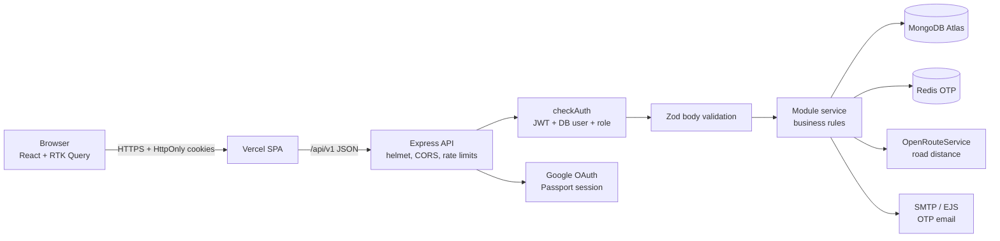

# AUDIT.md — GoMove Ride-Booking Platform: Independent Engineering Audit

**Audit date:** 2026-10-22  
**Scope:** `ride-booking-frontend` (HEAD `a8ea1ec`) and `ride-booking-system` (HEAD `2d76b11`), plus the root documentation files.  
**Audit-phase mode:** read-only static inspection. No product source, dependency, database, or Git state was modified during the audit. The approved P0/P1 remediation is recorded separately in Section K.  
**Important:** the existing root `AUDIT.md` is a previous, pre-remediation audit. This report supersedes it.  
**Remediation status:** the audit phase was read-only. After plan approval, the P0/P1 batch in Section K was applied; findings below describe the pre-remediation state unless marked otherwise.  
**Limitation:** the audit phase ran under plan mode, so lint/build/test/browser commands were blocked then. Post-approval verification is recorded in Sections F and K; all findings are grounded in source unless stated otherwise.

---

## Section A — Executive summary

GoMove is a two-repository ride-booking platform. The frontend is a React 19 + Vite SPA with RTK Query, cookie-based auth, Leaflet maps, and role dashboards for riders, drivers, and admins. The backend is an Express 5 + TypeScript + Mongoose 9 API using Zod validation, JWT access/refresh cookies, Passport local/Google auth, MongoDB Atlas, Redis-backed OTPs, SMTP email, and OpenRouteService (ORS) road-distance fares. Riders book with map coordinates, the server computes the fare, approved drivers accept from a pending queue, and the ride moves through a server-enforced state machine. There is no payments, ratings, live-position, or geocoding module.

The strongest engineering decisions are real, not cosmetic: the server is the only price authority and fails closed on routing failure; driver acceptance uses conditional updates; role checks are centralized in `checkAuth`; request bodies are Zod-validated; the ride lifecycle has meaningful integration tests against an in-memory replica set; the UI now has shared account/session, toast, path, ride-contract, and design-token abstractions.

The most important verified risks are:

- A documented seed flow creates a public ADMIN account with a published password (`admin@seed.gomove.app` / `Seed!Ride123`). If the deployment database was seeded as documented, this is a live administrator takeover, not a theoretical issue.
- Any self-registered DRIVER can create a profile and call `GET /driver/incoming-requests` without approval or being online, receiving rider names, emails, phone numbers, and precise pickup/destination coordinates.
- A rider could replace the ownership filter on ride history with `?riderId=...` and read another rider's history (confirmed IDOR; fixed in the approved remediation batch).
- A rider-accessible ride-details endpoint populates the driver's full user document, including the bcrypt password hash and auth-provider data.
- Google sign-in links to an existing unverified credentials account without proving ownership, enabling account takeover if an attacker pre-registered the victim's email.
- Expiry updates the ride and the rider's `riderStatus` in two separate writes; a crash between them can permanently block a rider from booking.
- Both ride-detail pages create an unstable array dependency and re-fetch the ORS route after every render, producing an endless request/render loop.
- The change-password mutation uses `PATCH`, while the backend route is `POST`; the password-change feature is broken on every profile page.
- The EJS email templates are not copied into `dist`; `npm start` cannot render the OTP email that registration depends on.
- Redis, SMTP, Google, and ORS variables are all treated as mandatory at boot, and Redis is awaited before the HTTP server starts. The documented "optional, degrades gracefully" claim is false.
- SUPER_ADMIN is admitted into the admin UI but excluded from most admin API routes, producing 403s in ride oversight, ride details, driver management, and admin stats.

The core booking journey is **statically connected and mostly coherent** for an ordinary RIDER/ADMIN pair: frontend request shapes match the backend, ownership checks exist for rider cancellation and driver status updates, and the state machine is enforced. Its security-critical branches, lifecycle, and ride-integrity paths are now exercised hermetically: the security-regression suite passes 20/20, the real login endpoint passes, the lifecycle suite uses a deterministic fare provider, and the full backend suite passes 46/46 with 1 opt-in live-ORS test skipped. Driver/admin cancellation, an active-ride lock, idempotent booking, and transaction retries are in place (Section K). The remaining uncertainties are the deployed environment (seed/demo credentials, Vercel asset bundling, Git history for old secrets) and product decisions around fees and completion evidence.

Recommended order: (1) remove the public-admin/demo-login risk and rotate any exposed secrets; (2) gate the driver queue and stop sensitive-field exposure; (3) fix the account-linking, expiry, loop, password-method, template-build, and boot-dependency defects; (4) make role gates, seed, statistics, pagination, error handling, and tests consistent; (5) improve accessibility, intervention flows, and maintainability.

---

## Section B — Architecture overview

### B.1 Baseline inventory

| Area | Actual implementation | Evidence | Status |
|---|---|---|---|
| Frontend | React 19, Vite 7, TypeScript 5.8, RTK Query, React Router 7, Tailwind v4, shadcn/ui, Leaflet/react-leaflet 5, Recharts, Vitest 3 + RTL | `ride-booking-frontend/package.json`, `src/main.tsx`, `src/routes/index.tsx`, `src/redux/baseApi.ts` | Confirmed |
| Backend | Express 5.3, TypeScript 5.8 CommonJS, Mongoose 9, Zod 4, Passport local + Google, JWT, Redis, SMTP, ORS | `ride-booking-system/package.json`, `src/app.ts`, `src/server.ts`, `src/app/routes/index.ts` | Confirmed |
| Database | MongoDB Atlas; three models: `User`, `Driver`, `Ride`; no migrations; indexes on ride status/requestedAt, riderId/status/createdAt, driverId/status/createdAt, and two 2dsphere indexes | `src/app/modules/*/*.model.ts` | Confirmed |
| Authentication | Passport local credentials and Google OAuth; JWT access + refresh tokens in HttpOnly cookies and login response body; DB re-query and role check per request; blocked/suspended checks | `src/app/middlewares/checkAuth.ts`, `src/app/config/passport.ts`, `src/app/utils/setCookie.ts`, `src/app/utils/userTokens.ts` | Confirmed |
| API contract | `/api/v1` modules: auth, user, otp, ride, driver, admin, stats; flexible response envelope; frontend RTK Query endpoints | `src/app/routes/index.ts`, `frontend/src/redux/features/*/*.api.ts` | Confirmed, with inconsistencies |
| Tests | Backend: 4 files, 21 tests (lifecycle, expiry, fares, validation, one mocked fare failure). Frontend: 4 files, 21 unit/helper tests | `ride-booking-system/tests/*`, `frontend/src/**/*.test.ts(x)` | Static count confirmed; execution not reproduced |
| Deployment | Two Vercel projects; backend `vercel.json` builds `dist/server.js`; frontend SPA rewrite; Atlas; no CI workflow | `ride-booking-system/vercel.json`, `frontend/vercel.json`, repository root | Confirmed from config; environment unverified |
| README accuracy | Mostly accurate on stack and high-level behavior; inaccurate on seed success, optional Redis/SMTP, demo-login production default, SUPER_ADMIN access, and "nothing secret ships" | `README.md` in both repos, `DEPLOYMENT.md`, `ENGINEERING_DECISIONS.md` | Confirmed contradictions |

### B.2 Request flow

Trust boundaries: the browser is untrusted; the API is the security boundary; MongoDB is the source of truth; Redis, SMTP, ORS, and Google are external dependencies. The frontend route guards are convenience only. CORS is restricted to `FRONTEND_URL` plus `localhost:5173`; production cookies are `HttpOnly`, `Secure`, `SameSite=None`, which is required for the cross-site Vercel deployment but creates CSRF considerations.

### B.3 Module responsibilities

- `auth`: login, logout, refresh, change password, Google callback.
- `user`: registration, self profile, admin user list, block/unblock, role setup.
- `otp`: email OTP send/verify; Redis TTL; SMTP EJS templates.
- `ride`: booking, fare calculation, rider history, cancel, admin ride list/detail.
- `driver`: profile, approval, online state, incoming queue, accept/reject, status transitions, earnings.
- `admin`: small system-stats endpoint (frontend uses `/stats/earning-history` instead).
- `stats`: admin, driver, and rider aggregations (daily/weekly/monthly).
- `frontend`: public marketing pages; role dashboards; shared session/toast/path/ride utilities; RTK Query APIs.

### B.4 Deployment reality

- Backend `vercel.json` uses the legacy `builds` form pointing at `dist/server.js`; it does not declare a build command. Whether Vercel actually runs `tsc` before packaging must be verified in project settings.
- Frontend `vercel.json` rewrites all paths to `index.html`.
- No `.github/workflows` or other CI configuration exists in either repository.
- `dist/` exists locally and contains `app/` and `scripts/`, but **not** `app/utils/templates/`; this is direct evidence for the OTP-template finding.

---

## Section C — Business logic

### C.1 Domain model

| Entity | Purpose | Important fields / invariants | Ownership and operations |
|---|---|---|---|
| `User` | Identity for riders, drivers, admins | `email` unique; `password` optional; `auths[]`; `role` optional until role setup; `isVerified`; `isBlocked` + `status`; `riderStatus`; `contactNo` | Created by registration or Google; role chosen once via self-update; admins can block/unblock; profile self-edit |
| `Driver` | Driver-specific profile | `user` ref; `vehicleInfo` free text; `isApproved`; `isOnline`; `totalEarnings` (unused); **no unique index on `user`** | Created by a DRIVER; approved/suspended by admin; self online toggle |
| `Ride` | Trip record and lifecycle | `riderId` → User; `driverId` → Driver; three GeoJSON points; `distance` ≥0; `fare` ≥0; `status`; `cancelReason`; custom `timestamps`; `rejectedBy[]` | Created by rider; claimed by driver; advanced by assigned driver; cancelled by rider before pickup; expired by lazy scan |

There is no separate Rider entity, Vehicle entity, Payment entity, Rating entity, or administrative audit entity. `vehicleInfo` is a free-text string. `Driver.totalEarnings` is never written. `User.location` exists in the TypeScript interface but not in the Mongoose schema. `RideStatus.REJECTED` and `RiderStatus.WAITING`/`PICKED_UP` are effectively dead states.

The duplicated sources of truth are intentional but risky:
- Ride lifecycle state exists in `Ride.status` and is mirrored in `User.riderStatus`.
- Account restriction exists in both `User.isBlocked` and `User.status`.
- Driver availability exists in `Driver.isOnline` and is inferred in frontend gates.

### C.2 Business-rules inventory

| Workflow | Actor | Preconditions | Rules and effects | Failure behavior | Authorization | Tests |
|---|---|---|---|---|---|---|
| Register | Public | Unique email; password policy | Hash password, create unverified User; role must be RIDER or DRIVER | 400 duplicate/invalid; response currently includes password hash | Public | Frontend form only; no backend registration test |
| OTP send | Public | User exists and is unverified | Generate 6-digit OTP, store in Redis 120s, send EJS email | 404/401; SMTP failure 502; Redis failure 500 | Public, rate-limited per IP | None |
| OTP verify | Public | Matching unexpired OTP | Set `isVerified=true`; delete OTP | 401 invalid/expired | Public, rate-limited per IP | None |
| Login | Public | Verified, not blocked/suspended, password matches | Issue access + refresh JWTs and cookies | 401 | Public, rate-limited per IP | "Login works" test uses a pre-signed token, not the endpoint |
| Role setup | Authenticated role-less user | No existing role | One-time role choice RIDER/DRIVER | 403/400 | Self only | None |
| Book ride | RIDER | No `riderStatus` REQUESTED/ON_RIDE; coordinates valid and different | Expire stale requests; compute ORS fare; create REQUESTED ride; set riderStatus REQUESTED, transactionally | 400/503; no ride on fare failure | RIDER | Yes |
| Incoming queue | DRIVER | Driver profile exists (approval/online **not** enforced) | List REQUESTED rides excluding `rejectedBy`; includes rider PII | 200 or error | DRIVER | Expiry only; no authorization test |
| Accept | DRIVER | Approved + online + no active ride; ride REQUESTED and not rejected by this driver | Conditional update to ACCEPTED; `acceptedAt`; one winner under race | 403/409; retries transient conflicts | DRIVER | Yes |
| Reject | DRIVER | Approved + online; ride REQUESTED | Add profile to `rejectedBy`; ride stays REQUESTED | 404/400; idempotent for already rejected | DRIVER | Yes |
| Advance status | Assigned DRIVER | Ride in exact predecessor state | ACCEPTED→PICKED_UP→IN_TRANSIT→ARRIVED→COMPLETED; write timestamp; set rider ON_RIDE/IDLE | 400/403/409 | Driver assignment checked in filter | Yes |
| Cancel | RIDER | Ownership; status REQUESTED or ACCEPTED | Set CANCELLED/BY_RIDER; rider IDLE; timestamps | 403/400/409 | Ownership checked atomically | Yes |
| Expiry | System (on read/accept/book) | REQUESTED older than 15 min | Set CANCELLED/NO_DRIVER; reset rider IDLE if no live ride | Non-atomic rider reset | System | Yes, but not crash-safe |
| Admin oversight | ADMIN | Role | Read rides/users; block/unblock; approve/suspend drivers; no cancel/override | 403 for SUPER_ADMIN on most routes | Role middleware | Partial |
| Earnings/stats | Driver/rider/admin | Role | Aggregate COMPLETED rides by fares | No payments; fare = income | Role middleware | Yes/partial |

### C.3 Rider journey trace

1. **Authentication:** implemented with register → OTP → login; cookie JWT; blocked/suspended handling.
2. **Pickup/destination entry:** implemented as map-only. Pickup is browser geolocation; destination is a map click. No text address, geocoding, manual pickup, or keyboard alternative.
3. **Location validation:** backend validates coordinate ranges and rejects identical pickup/destination; no service-area or address validation.
4. **Fare estimate:** frontend optionally calls ORS directly and falls back to straight-line distance; server recomputes using ORS and is authoritative. Client-supplied fare/distance are stripped by Zod.
5. **Ride creation:** implemented; transactional ride + riderStatus; rate-limited; ORS failure returns 503 and persists nothing.
6. **Driver matching:** manual pending queue; no automatic nearest-driver assignment.
7. **Driver information:** populated on ride details (`driverId.user`); ride-details endpoint currently over-populates the user document.
8. **Progress:** 5-second polling; status timeline and map; driver position is never updated, so the "driver marker" is the request-time `currentLocation`, not live position.
9. **Cancellation:** allowed for REQUESTED and ACCEPTED (before pickup); not after pickup; no admin/driver cancel.
10. **Completion/final fare:** fare is computed at request time and never revised; completion sets rider IDLE; no receipt/payment.
11. **History:** server-side paginated rider history with status/search/date; fare range is client-side and only filters the current page.
12. **Rating/payment/support:** not implemented; cash settlement is stated in the UI; SOS is client-side only.

### C.4 Driver journey trace

1. **Authentication/approval:** driver registers, creates profile, waits for admin approval; approval and online gates protect accept/reject, but not the incoming-request listing.
2. **Availability:** self toggle only if approved; a driver can go offline while on an active ride.
3. **Eligible rides:** pending REQUESTED rides, excluding previously rejected; no geographic filtering or distance ordering.
4. **Acceptance:** conditional update, one winner for the same ride; same-driver simultaneous acceptance of two different rides is not atomically prevented.
5. **Pickup/arrival/start:** status buttons advance the state machine; no location or duration proof.
6. **Completion:** state machine requires each intermediate status, but a driver can click through all states immediately; fare is already stored.
7. **Cancellation/rejection:** rejection before acceptance only; no driver cancel/no-show after acceptance.
8. **Earnings/history:** completed fares only; history labels `createdAt` as "Completed At"; overview cards sum all historical buckets.

### C.5 Ride state machine (actual)

| Current state | Action | Actor | Expected result | Actual implementation | Test evidence |
|---|---|---|---|---|---|
| REQUESTED | accept | DRIVER | ACCEPTED + driverId + acceptedAt | Conditional `findOneAndUpdate` with status/rejectedBy; transaction; 409 on loss | Two-driver race test |
| REQUESTED | reject | DRIVER | Still REQUESTED; `rejectedBy` includes driver | Conditional `$addToSet`; idempotent for existing rejection | Reject/re-accept test |
| REQUESTED | cancel | RIDER | CANCELLED/BY_RIDER; rider IDLE | Conditional update; transaction | Cancel tests |
| REQUESTED | expire after 15 min | System | CANCELLED/NO_DRIVER; rider IDLE | Lazy scan + two separate writes | Expiry tests |
| ACCEPTED | PICKED_UP | Assigned DRIVER | PICKED_UP + pickedUpAt; rider ON_RIDE | Conditional update + user update in transaction | Full walk test |
| ACCEPTED | cancel | RIDER | CANCELLED/BY_RIDER | Allowed by cancel filter | Cancel-after-accept test |
| PICKED_UP | IN_TRANSIT | Assigned DRIVER | IN_TRANSIT + startedAt | Conditional update | Full walk test |
| IN_TRANSIT | ARRIVED | Assigned DRIVER | ARRIVED + arrivedAt | Conditional update | Full walk test |
| ARRIVED | COMPLETED | Assigned DRIVER | COMPLETED + completedAt; rider IDLE | Conditional update + user update | Full walk test |
| COMPLETED/CANCELLED | any | any | Rejected | Terminal; filter misses; 400/409 | Repeat/terminal tests |
| ACCEPTED/PICKED_UP/IN_TRANSIT/ARRIVED | timeout/abandon | System/Admin | No defined recovery | No expiry, no admin cancel, no driver cancel | None |
| Any | admin cancel | ADMIN | Not implemented | No endpoint | None |

### C.6 Fare calculation path

1. Frontend optionally calls `https://api.openrouteservice.org/v2/directions/driving-car/geojson` with `VITE_ORS_API_KEY`; on failure it uses haversine straight-line distance for the preview.
2. On booking, the frontend sends only `pickupLocation` and `destination` (plus a `currentLocation` that the Zod schema strips; the controller defaults currentLocation to pickup).
3. `RideServices.requestRide` opens a MongoDB transaction, reads the rider, calls `fareCalulator` (ORS), computes `distanceKm = meters / 1000` rounded to 2 decimals and `fare = distanceKm * 100` rounded to 2 decimals, creates the ride, and sets riderStatus.
4. ORS failure throws `AppError 503`; the transaction aborts and no ride persists. This is the correct fail-closed policy.
5. The server never trusts client fares. The frontend estimate is UX-only, but it is not labeled as straight-line when the fallback is used.

Open fare questions: no minimum fare, no cancellation fee, no service-area bounds, no currency field, no commission split, no final-fare adjustment, and no idempotency key. These are product decisions except idempotency, which is a reliability concern.

### C.7 Concurrency and race analysis

- **Two drivers accept the same ride:** conditional filter makes one winner; the loser's filter misses and `explainAcceptBlock` returns 409. Good.
- **Rider cancels while driver accepts:** both update the same ride conditionally; one should win. `cancelRide` does not retry `TransientTransactionError`, so a write conflict can surface as 500 instead of a clean 400/409.
- **Same driver accepts two different rides:** both transactions read `Ride.exists(active)=false`, then update different ride documents. No common document is written, so both transactions can commit. This is a real gap, not just a theoretical one; the docs call it "best-effort."
- **Duplicate booking requests:** both transactions read `riderStatus=IDLE`; both create rides and update the same user document; one commit can conflict. `requestRide` has no retry, so the loser can get 500.
- **Duplicate completion/status requests:** the predecessor-state filter rejects repeats; sequential repeats return 409. Concurrent different transitions can write-conflict, again without retry.
- **Expiry vs accept:** the accept filter requires REQUESTED, and expiry updateMany requires REQUESTED, so one wins. The rider reset is not in the same transaction as the ride cancellation.
- **Duplicate driver profiles:** `createDriver` checks then creates; no unique index on `Driver.user`; concurrent requests can create duplicates.
- **Payment/concurrent fare:** not applicable; no payments module.

**Post-remediation state (Section K):** lifecycle writes share `withTransaction` (transient retry, 409 on exhaustion); the same-driver race is serialized by `Driver.activeRideId`; `Driver.user` is unique; booking has a unique sparse idempotency key; fare calculation moved before the transaction with an 8s provider timeout; driver cancel (ACCEPTED only) and admin cancel (any non-terminal, reason required) release both parties. The remaining concurrency caveat is the same driver accepting two rides across two devices only if the legacy fallback cannot see an active ride; the new lock covers normal and concurrent new claims.

---

## Section D — API contract review

### D.1 Endpoint matrix (frontend ↔ backend)

| Group | Endpoint | Backend roles | Frontend consumer | Status |
|---|---|---|---|---|
| auth | `POST /auth/login` | public | `auth.api.ts` | Matches |
| auth | `POST /auth/logout` | public | `auth.api.ts` | Matches |
| auth | `POST /auth/refresh-token` | public | none | Backend-only; refresh unused by FE |
| auth | `POST /auth/change-password` | any authenticated | `auth.api.ts` uses **PATCH** | **Mismatch: 404** |
| auth | `GET /auth/google` + callback | public | login/register buttons | Path matches `/api/v1/auth/google`; `GOOGLE_LOGIN_PATH` constant is stale/unused |
| otp | `POST /otp/send`, `/verify` | public | `auth.api.ts` | Matches |
| user | `POST /user/register` | public | `auth.api.ts` | Matches; response over-exposes hash |
| user | `GET /user/me` | any authenticated; blocked users allowed for this path | `useAccount`, profiles | Matches |
| user | `PATCH /user/:id` | self | profile pages, role setup | Matches; self-only check in service |
| user | `GET /user`, `GET /user/:id`, block/unblock | ADMIN, SUPER_ADMIN | admin user management | Roles match; frontend ignores pagination |
| ride | `POST /ride/request` | RIDER | booking page | Matches; optional `Idempotency-Key` header (added in remediation) |
| ride | `GET /ride/latest-ride` | RIDER | booking page | Matches; double-wrapped payload |
| ride | `GET /ride/my-ride/:rideId` | RIDER | details/booking | Matches; password leak fixed in Section K |
| ride | `GET /ride/all-my-rides` | RIDER | rider history/overview | Matches; nested `data` + `meta` |
| ride | `PATCH /ride/cancel/:id` | RIDER | booking/details | Matches |
| ride | `PATCH /ride/admin-cancel/:id` | ADMIN, SUPER_ADMIN | admin ride details | Added in remediation; required reason |
| ride | `GET /ride/me` | RIDER | none | Backend-only |
| ride | `GET /ride/single-ride/:id`, `/all-rides-admin` | ADMIN, SUPER_ADMIN | admin ride pages | SUPER_ADMIN hierarchy fixed in Section K |
| ride | `GET /ride` | none (commented out) | dead `useGetAllRidesQuery` | **No backend route** |
| driver | `POST/PATCH /driver/profile`, `GET /profile/me` | DRIVER | driver profile/overview | Matches |
| driver | `PATCH /driver/status` | DRIVER | availability | Matches |
| driver | `GET /driver/incoming-requests` | approved+online DRIVER | incoming queue | Approval/PII issue fixed in Section K |
| driver | `GET /driver/active-ride` | DRIVER | driver overview | Matches; double-wrapped |
| driver | `PATCH /driver/:id/accept|reject|cancel|status` | DRIVER | driver queue/overview | Cancel (pre-pickup) added in remediation |
| driver | `GET /driver`, approve/suspend | ADMIN, SUPER_ADMIN | admin user management | SUPER_ADMIN hierarchy fixed in Section K |
| driver | `GET /driver/earnings/me` | DRIVER | driver history | Matches |
| stats | `GET /stats/earning-history` | ADMIN, SUPER_ADMIN | admin analytics | Matches |
| stats | `GET /stats/my-earning-history` | DRIVER | driver overview | Matches |
| stats | `GET /stats/my-all-ride-history` | RIDER | rider overview | Matches |
| admin | `GET /admin/stats` | ADMIN only | none | Backend-only; inconsistent with stats service |

### D.2 Contract findings

- **HTTP method mismatch:** `changePassword` is `PATCH` in `frontend/src/redux/features/auth/auth.api.ts`, but `auth.route.ts` registers `router.post("/change-password", ...)`. Every profile page includes `ChangePasswordCard`, so the feature returns 404.
- **Dead endpoint:** `GET /ride` is commented out in `ride.route.ts`; `useGetAllRidesQuery` is exported but unused. It would 404 if used.
- **Role mismatch:** `checkAuth` uses strict `authRoles.includes(role)`. `SUPER_ADMIN` is not included in `ADMIN` routes for rides, drivers, or `/admin/stats`, while the frontend admin route allows both roles.
- **Envelope inconsistency:** some controllers return `data: {data, meta}` (latest/active/incoming/all-my-rides/all-rides-admin), some return `data` plus top-level `meta` (users), and some return plain `data`. The frontend's `extractData`/`extractArrayData`/`extractMeta` intentionally handles double nesting, which masks the inconsistency.
- **Nullability/population:** ride details populate `driverId.user` fully; admin ride details populate only `driverId`; incoming queue replaces `riderId` with a projected rider object; history populates only `driverId`. Frontend helpers tolerate multiple shapes, but the contract is not explicit.
- **Pagination:** `QueryBuilder` default limit is 30; incoming/admin ride lists default 10; frontend user management fetches no params (first 30 only); rider fare filtering is client-side over one page.
- **Validation:** body validation is strong; query validation is absent. `page`, `limit`, `status`, `searchTerm`, `dateSearch`, `sort`, and `fields` are passed into Mongo/QueryBuilder without bounds or allowlists.
- **Error format:** most errors follow `{success:false, message, errorSources}`; however, JWT errors and malformed JSON fall through to 500 with raw `err.message`, and 5xx bodies leak internal messages. Frontend `getApiErrorMessage` handles the envelope reasonably.
- **Authentication vs authorization:** ride ownership and driver assignment checks are present; admin role gates are present but inconsistent; the incoming-queue approval gate is missing.

---

## Section E — Findings register

Severity scale used: **P0** critical, **P1** high, **P2** medium, **P3** low, **Informational**. Status: **Confirmed**, **Likely**, **Design risk**, **Improvement**, **Unverified**.

### AUD-001 — Documented seed creates a public administrator account; demo login defaults on in production

- **Severity:** P0 (conditional on deployment state)  
- **Category:** Security / Operations  
- **Status:** Confirmed in source; deployed state Unverified  
- **Location:** `ride-booking-system/src/scripts/seed.ts` (`SEED_PASSWORD`, `SEED_ACCOUNTS`), `ride-booking-frontend/src/config/index.ts` (`resolveDemoLoginEnabled`), `ride-booking-frontend/.env.example`, both READMEs, `DEPLOYMENT.md`
- **Observation:** The seed creates `admin@seed.gomove.app` with the literal password `Seed!Ride123`, role ADMIN, verified. The README publishes that credential. `DEPLOYMENT.md` instructs running `npm run seed` against the target database. The frontend demo-login default is `true` when `VITE_ENABLE_DEMO_LOGIN` is unset; `.env.example` claims the default is false in production. The seed creates the admin account before the ride-seeding step that currently fails, so even a failed seed leaves the account behind.
- **Impact:** Anyone who can read the public repository can authenticate as an administrator on any deployment whose database was seeded as documented. That permits reading all users/rides, blocking users, and approving/suspending drivers. Combined with the demo quick-login, the credential may be exposed in the UI.
- **Scenario:** Owner follows the deployment runbook, runs `npm run seed`, and deploys. An attacker reads the README, logs in as `admin@seed.gomove.app` with `Seed!Ride123`, and uses admin endpoints.
- **Evidence:** literal seed credentials and role; README credential table; deployment runbook; `resolveDemoLoginEnabled` returning `true` by default; `.env.example` comment claiming the opposite.
- **Recommendation:** Never create a known-password admin in a seed that can run against production. Require a strong `SEED_ADMIN_PASSWORD` from the environment, refuse to create demo accounts when `NODE_ENV=production`, remove real credentials from documentation, default demo login to false in production, and rotate/delete any existing seeded admin.
- **Acceptance criteria:** A production build has no demo quick-login unless explicitly enabled; seed refuses to create an ADMIN account with a hardcoded password in production; the documented credential no longer authenticates after rotation; README contains no live credentials.
- **Verification:** Deploy with demo env unset and confirm no buttons/credentials; run seed with `NODE_ENV=production` and confirm it aborts or requires a unique password; attempt the old login and confirm 401.
- **Trade-offs:** A demo deployment still needs a demo path. Use a separate demo database/project with explicitly marked demo accounts, or a time-limited demo token, rather than a production seed.

### AUD-031 — Rider history ownership could be replaced by a query filter (fixed during remediation)

- **Severity:** P0  
- **Category:** Security / Authorization / Database  
- **Status:** Confirmed by regression test; fixed in the approved remediation  
- **Location:** `ride-booking-system/src/app/utils/QueryBuilder.ts` (`filter`/`find`), `src/app/modules/ride/ride.service.ts` (`allRides`)
- **Observation:** `allRides` starts from `Ride.find({ riderId })`, but QueryBuilder called `Query.find()` again with the caller's filter. Mongoose replaces the current conditions on that call, so `?riderId=<other>` replaced the ownership scope. The new regression test returned another rider's completed ride before the fix.
- **Impact:** Unauthorized read of another rider's ride history, including pickup/destination coordinates, fare, status, and driver reference. This is an IDOR/privacy failure.
- **Scenario:** Rider A calls `/api/v1/ride/all-my-rides?riderId=<rider B id>` with their own token; the response contains B's rides.
- **Evidence:** the test `does not allow a rider to override the ownership scope` failed with `expected true to be false` before the `$and` merge and passes after it.
- **Recommendation:** Never call `find()` with a filter that replaces an ownership base; merge conditions with `$and` (implemented in `QueryBuilder.addCondition`). Keep the regression test.
- **Acceptance criteria:** no query parameter can remove the base `riderId` condition; the scoped regression test passes; pagination meta counts only the scoped set.
- **Verification:** security suite (20/20), including the scope regression test.
- **Trade-offs:** nested `$and` conditions; negligible cost for the integrity guarantee.

### AUD-002 — Unapproved or offline drivers can enumerate pending rides and rider PII

- **Severity:** P1  
- **Category:** Security / Privacy / Authorization  
- **Status:** Confirmed  
- **Location:** `ride-booking-system/src/app/modules/driver/driver.service.ts` (`getIncomingRequests`, `requireDriverProfile`), `driver.route.ts`, `user.validation.ts` (public registration allows DRIVER)
- **Observation:** `getIncomingRequests` calls `requireDriverProfile(userId)` with no approval/online option. Public registration allows anyone to choose DRIVER; `createDriver` only requires the role and a vehicle string. The endpoint returns rider `name`, `email`, `contactNo`, pickup/destination coordinates, and ride IDs, with a caller-controlled `limit` and no route-specific rate limiter.
- **Impact:** A newly registered driver can harvest rider contact details and precise locations without ever being approved or online. This is a privacy breach and enables stalking, spam, or competitive abuse. It also means the frontend approval gate is cosmetic.
- **Scenario:** Register as DRIVER → verify email → create profile → call `GET /api/v1/driver/incoming-requests?limit=1000` repeatedly → collect rider PII.
- **Evidence:** no `approvedAndOnline` argument at the call site; the listing pipeline projects rider name/email/contact; no approval check in the route; no rate limiter on the route.
- **Recommendation:** Require `{ approvedAndOnline: true }` for the queue; cap `limit` (e.g., 20); add a route-specific rate limiter; minimize pre-acceptance data (name/initial and pickup area only; reveal phone after acceptance); consider a per-driver offer token.
- **Acceptance criteria:** Unapproved/offline drivers receive 403; the queue is rate-limited; pre-acceptance responses do not expose rider email/phone/full coordinates; approved/online drivers still see actionable requests.
- **Verification:** Integration tests for unapproved, offline, and approved/online drivers; assert response fields; attempt a large `limit` and confirm 400/clamping.
- **Trade-offs:** Drivers need pickup location to decide. Return an approximate pickup point before acceptance and the exact point/contact after acceptance; this is a product decision but reduces exposure.

### AUD-003 — Password hashes and auth-provider data are exposed in API responses

- **Severity:** P1  
- **Category:** Security / Data exposure  
- **Status:** Confirmed for ride details, registration, and profile update
- **Location:** `ride-booking-system/src/app/modules/ride/ride.service.ts` (`singleRide` populate), `src/app/modules/user/user.service.ts` (`createUser`, `updateUser`), `src/app/modules/user/user.model.ts` (no `select:false` on password)
- **Observation:** `singleRide` uses `.populate({path:"driverId", populate:{path:"user"}})` with no field selection. The User schema does not mark `password` as `select:false`, so the response includes the driver's bcrypt hash, auth providers, status, and contact data. `createUser` returns the `User.create` document and `updateUser` returns the `findByIdAndUpdate` document without excluding `password`. The admin user list uses `.select("-password")` and does not call QueryBuilder `.fields()`, so it is not part of this exposure path.
- **Impact:** A rider can retrieve a driver's password hash; the ride-details page polls it every 5 seconds. Hashes can be cracked offline, and auth-provider/status data leaks. Registration/profile responses expose the caller's own hash and may be captured in logs/monitoring.
- **Scenario:** Book a ride → driver accepts → rider opens ride details or stays on the booking page → response contains `driverId.user.password`; copy it and attempt offline cracking. Or register/profile-update and inspect the JSON response for the hash.
- **Evidence:** populate without `select`; no schema-level `select:false`; `User.create` returned directly; `login` explicitly strips password, proving the field is otherwise present.
- **Recommendation:** Add `select:false` to the User password path as the default; explicitly select allowed fields on every populate; return DTOs for registration/update. Do not rely on per-call `-password` exclusions. QueryBuilder field selection is used on ride history, not this user path, but an allowlist is still good defense-in-depth.
- **Acceptance criteria:** No API response contains `password`, `auths`, or internal fields unless explicitly intended; ride-details responses contain only driver name/contact/vehicle; registration/update responses omit the hash.
- **Verification:** Integration tests that assert `password` is absent from every user-bearing response; a schema test that `User.findOne()` does not select password by default; a ride-details contract test.
- **Trade-offs:** Changing the schema default requires explicit `+password` in auth queries; that is preferable to relying on every call site.

### AUD-004 — Google sign-in can take over a pre-registered unverified credentials account

- **Severity:** P1  
- **Category:** Security / Authentication  
- **Status:** Confirmed logic  
- **Location:** `ride-booking-system/src/app/config/passport.ts` (Google verify callback), `src/app/modules/user/user.service.ts` (`createUser`)
- **Observation:** Registration creates a credentials account with an attacker-chosen password but leaves it unverified. Google sign-in finds an existing user by email, pushes the Google provider, and sets `isVerified=true`. It does not remove the existing password, require an OTP, or verify that the credentials account belonged to the Google email owner. Local login then accepts the credentials password because `isVerified` is true and a password exists.
- **Impact:** Account takeover of a victim who signs in with Google after an attacker pre-registered their email.
- **Scenario:** Attacker registers `victim@example.com` with password `Known!Pass1` (unverified). Victim later clicks "Login with Google" using the same email; the account becomes verified and linked. Attacker logs in with `victim@example.com` / `Known!Pass1` and receives the victim's session.
- **Evidence:** Google branch sets `isVerified=true` and appends the provider; the credentials branch remains; LocalStrategy only rejects Google-only accounts with no password.
- **Recommendation:** Only auto-link Google to an existing account if that account is already verified; if an unverified credentials account exists, require email OTP proof before linking, or invalidate the password and force a set-password flow after Google authentication. Record provider ownership and notify the user.
- **Acceptance criteria:** An unverified credentials account cannot be silently linked to Google; takeover scenario tests return a verification challenge or a separate-account outcome; legitimate Google linking still works for verified accounts.
- **Verification:** Integration test that registers an unverified user, performs a simulated Google callback, and asserts the old password no longer authenticates.
- **Trade-offs:** Extra friction for legitimate users with an existing unverified account; that friction is justified for account security.

### AUD-005 — Expiry resets ride and rider state in separate writes, allowing permanent rider lockout

- **Severity:** P1  
- **Category:** Business logic / Data integrity / Reliability  
- **Status:** Confirmed static logic  
- **Location:** `ride-booking-system/src/app/modules/ride/ride.service.ts` (`expireStaleRequestedRides`)
- **Observation:** The function first `updateMany`s stale rides to CANCELLED/NO_DRIVER, then runs `distinct` to find riders with remaining live rides, then `updateMany`s riders to IDLE. These are separate writes with no transaction or recovery marker. If the process crashes/timeouts after the ride update but before the rider update, the ride is terminal and no longer discoverable by the stale scan, while `riderStatus` remains REQUESTED. `requestRide` then rejects every future booking for that rider.
- **Impact:** A rider can be permanently unable to book, with no self-service recovery and no active ride to cancel. This is a core booking reliability failure.
- **Scenario:** Rider requests a ride; 15 minutes pass; a driver listing triggers expiry; the serverless invocation is terminated after the ride update but before the user update. The rider returns, sees no active ride, tries to book, and receives "already have a ride in REQUESTED state" forever.
- **Evidence:** two independent writes; no session/transaction; reset query only targets `riderStatus: REQUESTED`; no reconciliation job/endpoint.
- **Recommendation:** Wrap the ride cancellation and rider reset in one transaction, or make rider availability derive from active rides rather than a mirrored field. Add a repair/reconciliation path for inconsistent riders.
- **Acceptance criteria:** A crash between the two effects cannot leave a rider with no active ride and a blocking status; either both effects apply or neither; a test simulates a failure between writes.
- **Verification:** Fault-injection test that throws after the ride update; assert riderStatus is still consistent. Also test a rider with a cancelled ride and stale REQUESTED status can recover.
- **Trade-offs:** Transactions on every expiry scan add cost; deriving state removes the duplication but requires changing the booking guard and queries. A transaction around the existing two writes is the smallest fix.

### AUD-006 — Ride-detail pages re-fetch the ORS route after every render

- **Severity:** P1  
- **Category:** Frontend / Reliability / Cost  
- **Status:** Confirmed static behavior  
- **Location:** `ride-booking-frontend/src/pages/User/MyRideDetails.tsx`, `src/pages/Admin/RideDetails.tsx`
- **Observation:** Both pages compute `const pickup = getCoordinates(ride?.pickupLocation)` and `const destination = getCoordinates(...)` during render. `getCoordinates` returns a new array every call. A `useEffect` depends on `[pickup, destination]` and calls `setRouteCoordinates(route.coordinates)`, which stores another new array. Each state update re-renders, recreates the dependency arrays, and runs the effect again. With an ORS key, this is an endless ORS request loop; without a key, it is still an endless render/promise loop because `setRouteCoordinates([])` is a new array.
- **Impact:** High CPU/battery use, a visibly janky page, and rapid exhaustion of the ORS free-tier quota. This is amplified by React StrictMode in development and by the 3–5 second polling on the same pages.
- **Scenario:** Open `/my-ride/:id` for any ride with valid coordinates. The network panel shows repeated ORS requests; the page never settles.
- **Evidence:** unstable derived arrays in effect dependencies; state setter always receives a fresh array; no equality guard or memoization; same pattern in both detail pages. The booking page has a related but bounded variant: the polling effect sets new pickup/destination arrays, so a route request is made on each poll.
- **Recommendation:** Memoize coordinates by primitive values or depend on `ride?._id` / coordinate primitives, not array identities. Guard `setRouteCoordinates` against identical content. Abort in-flight ORS requests on cleanup. Apply the same equality guard to the booking page's poll sync.
- **Acceptance criteria:** One route request per ride load (and at most one per meaningful coordinate change); no render loop; no state update with an identical coordinate set; requests are aborted on unmount.
- **Verification:** React Profiler render count; network request count with a mocked ORS; StrictMode render test; unit test for a coordinate-equality helper.
- **Trade-offs:** Memoization adds a small amount of code; the current loop is far more expensive.

### AUD-007 — Change-password uses the wrong HTTP method and is broken on every profile page

- **Severity:** P1  
- **Category:** Frontend/API contract / Security workflow  
- **Status:** Confirmed  
- **Location:** `ride-booking-frontend/src/redux/features/auth/auth.api.ts` (`changePassword`, method `PATCH`), `ride-booking-system/src/app/modules/auth/auth.route.ts` (`router.post("/change-password", ...)`), `frontend/src/components/shared/account/ChangePasswordCard.tsx`
- **Observation:** The frontend sends `PATCH /api/v1/auth/change-password`; the backend only registers `POST`. The card is mounted in rider, driver, and admin profile pages.
- **Impact:** No user can change their password through the UI; the request returns the generic 404 "Route Not Found". This blocks a basic account-security operation.
- **Scenario:** Open any profile → enter current/new password → submit → 404 toast; password unchanged.
- **Evidence:** direct comparison of the endpoint definitions; the backend has no PATCH alias.
- **Recommendation:** Change the frontend mutation to `POST` (smallest fix) or add a documented PATCH alias if clients require it. Add a contract test that asserts method/path pairs.
- **Acceptance criteria:** Profile password change returns 200; the old password no longer logs in; the new password does; validation errors are surfaced.
- **Verification:** Backend supertest for POST; frontend MSW/contract test for the method; manual profile flow.
- **Trade-offs:** None; choose one method and document it.

### AUD-008 — EJS email templates are not included in the production build

- **Severity:** P1  
- **Category:** Operations / Build / Registration  
- **Status:** Confirmed for `npm start`; Likely for Vercel  
- **Location:** `ride-booking-system/package.json` (`"build": "tsc"`), `tsconfig.json` (`include: ["src"]`, `outDir: dist`), `src/app/utils/sendEmail.ts` (`path.join(__dirname, "templates/...")`), `src/app/utils/templates/`
- **Observation:** `tsc` emits JavaScript only; it does not copy `.ejs` assets. The local `dist/` exists with `app/` and `scripts/`, but `dist/app/utils/templates/` does not exist. `sendEmail` resolves templates relative to `__dirname`, so `node dist/server.js` / `npm start` cannot render `otp.ejs`. Vercel's legacy `builds` configuration points at `dist/server.js`; unless the platform traces and includes the EJS files, the deployed OTP email fails too.
- **Impact:** Registration verification emails fail in production; new users cannot verify and therefore cannot log in. The failure appears as a 502/email error, not an obvious deployment error.
- **Scenario:** Build, run `npm start`, register a user, call OTP send → EJS `ENOENT` → 502; no OTP delivered.
- **Evidence:** build script is `tsc`; no copy/postbuild script; `dist/app/utils/templates` missing; `__dirname`-relative read.
- **Recommendation:** Add a cross-platform copy step to the build (or inline/compile templates), or resolve templates from a path that is guaranteed to ship. Add a startup/test assertion that required templates exist. Verify Vercel's function bundle includes them.
- **Acceptance criteria:** `npm run build && npm start` renders the OTP template; deployed OTP send returns 200 and delivers mail; a build test fails if templates are missing.
- **Verification:** Build, inspect `dist`, send an OTP through the real endpoint (or a mocked mailer), confirm the template loads.
- **Trade-offs:** Copying assets is simple; bundling templates into the JS removes filesystem assumptions but changes the template workflow.

### AUD-009 — Redis, SMTP, Google, and ORS are mandatory at boot; the server does not start without Redis

- **Severity:** P1  
- **Category:** Operations / Developer experience / Reliability  
- **Status:** Confirmed  
- **Location:** `ride-booking-system/src/app/config/env.ts` (all variables required), `src/server.ts` (`await connectRedis()` before `startServer`), `src/app/config/redis.config.ts`, `src/app/modules/otp/otp.service.ts`, README/DEPLOYMENT
- **Observation:** `env.ts` throws if any SMTP, Redis, Google, or ORS variable is missing. `server.ts` awaits `connectRedis()` before listening. `redisClient` has no disabled/in-memory fallback. The docs claim Redis/SMTP are optional and that the app still boots without Redis; that is false. The OTP service calls Redis directly. A local `.env` built from `.env.example` contains placeholder hosts, so `npm run dev` will attempt a real Redis connection to `your_redis_host` and either hang or fail before the API listens.
- **Impact:** Offline development and degraded deployments are impossible; a Redis outage prevents the entire API from starting, not just OTP. This contradicts the project's stated graceful-fallback goal.
- **Scenario:** New developer copies `.env.example`, runs `npm run dev` with no Redis → server never listens; or production Redis is unavailable → cold start fails.
- **Evidence:** required-variable loop; `await connectRedis()` before `startServer()`; no `isOpen`/fallback branch in OTP; docs claims.
- **Recommendation:** Make optional service groups conditional; start HTTP first; connect Redis lazily with a controlled degradation (OTP returns 503, rest of API works); skip Google strategy when credentials are absent; make ORS a documented booking dependency. Add a `NODE_ENV`-aware configuration validator with clear messages.
- **Acceptance criteria:** `npm run dev` starts with no Redis/SMTP/Google; booking either works with a valid ORS key or returns the documented 503; OTP returns a controlled 503 without Redis/SMTP; production still fails fast on truly required variables.
- **Verification:** Boot with optional vars absent; call health, booking, and OTP; assert controlled errors and no hang. Add a config unit test.
- **Trade-offs:** Degraded mode means some features are unavailable; that is better than a dead API. Keep production validation strict for required services.

### AUD-010 — SUPER_ADMIN is admitted to the admin UI but blocked from most admin APIs

- **Severity:** P2  
- **Category:** Authorization / Role consistency  
- **Status:** Confirmed  
- **Location:** `ride-booking-system/src/app/modules/ride/ride.route.ts`, `driver.route.ts`, `admin.route.ts` (`checkAuth(Role.ADMIN)`), `user.route.ts` and `stats.route.ts` (include SUPER_ADMIN), `frontend/src/routes/index.tsx` (admin route allows both)
- **Observation:** `checkAuth` performs a strict role inclusion; `SUPER_ADMIN` does not inherit `ADMIN`. Ride oversight, ride detail, driver list, approve/suspend, and `/admin/stats` require only `ADMIN`. The frontend admin route and sidebar allow `SUPER_ADMIN`. User list and `/stats/earning-history` allow both.
- **Impact:** The seeded SUPER_ADMIN can log into the admin UI but receives 403 on Ride Oversight, Ride Details, driver management, and `/admin/stats`; User Management partially fails because the driver list request is 403, leaving approve/suspend disabled. This is a broken role experience and a confusing authorization model.
- **Scenario:** Log in as the super admin → open Ride Oversight → empty/error; open User Management → users load but no driver profiles; approve buttons disabled.
- **Evidence:** route role arrays; strict `includes`; frontend route guard; explore pass confirmed the 403 paths.
- **Recommendation:** Define a role hierarchy or include `SUPER_ADMIN` in every admin route. Prefer a single `requireAdmin`/`requireRole` helper with explicit inheritance. Add a route-role matrix test.
- **Acceptance criteria:** SUPER_ADMIN can access every admin endpoint that ADMIN can; rider/driver endpoints remain restricted; an automated matrix test covers all roles/routes.
- **Verification:** Supertest matrix for ADMIN and SUPER_ADMIN on each admin route; frontend smoke as both roles.
- **Trade-offs:** If SUPER_ADMIN is intended to be read-only or different, encode that explicitly and adjust the UI; do not leave the current implicit inconsistency.

### AUD-011 — Seed cannot complete a ride on a clean database because the driver is never online

- **Severity:** P2  
- **Category:** Operations / Seed / Documentation  
- **Status:** Confirmed  
- **Location:** `ride-booking-system/src/scripts/seed.ts` (`createDriver`, `approveDriver`, `finishRide`)
- **Observation:** The seed creates a driver profile (default `isOnline:false`), approves it, then calls `DriverServices.acceptRide`, which requires `isApproved && isOnline`. The seed never calls `driverStatus(..., true)`. On a clean database, the first completed-ride step throws 403 and the seed exits 1. Because the seed creates the admin/rider/driver accounts before this failure, a failed seed still leaves the public admin account from AUD-001.
- **Impact:** The documented `npm run seed` demo flow does not work; a recruiter or reviewer cannot get the promised sample data. The failure also leaves partial state, undermining the "idempotent" claim.
- **Scenario:** Fresh database → `npm run seed` → admin/rider/driver created → accept fails "Driver is not approved or online" → process exits 1; no completed/cancelled rides.
- **Evidence:** `Driver` default `isOnline:false`; no online call in seed; `acceptRide` gate.
- **Recommendation:** Set the seed driver online through the real service before accepting, and make the seed transactional/idempotent or clearly resumable. Refuse known-password admin creation in production (AUD-001).
- **Acceptance criteria:** On a clean DB, `npm run seed` exits 0 and creates one completed and one cancelled ride; rerunning does not duplicate; a production guard prevents demo admin creation.
- **Verification:** Run against an in-memory/temporary replica set; assert counts and statuses; run twice.
- **Trade-offs:** Seed uses real ORS; if ORS is unavailable, the seed should fail with a clear message or use a documented fixture mode.

### AUD-012 — JWT and malformed-input errors become 500s with raw messages; production errors are not logged

- **Severity:** P2  
- **Category:** API contract / Security / Observability  
- **Status:** Confirmed static logic  
- **Location:** `ride-booking-system/src/app/middlewares/globalErrorHandler.ts`, `src/app/utils/jwt.ts`, `src/app/middlewares/checkAuth.ts`
- **Observation:** `verifyToken` lets `JsonWebTokenError`/`TokenExpiredError` propagate. The global handler's only `Error` branch sets status 500 and `message = err.message`. Invalid JSON bodies similarly become 500. The handler logs only when `NODE_ENV === "development"`, so production 5xx errors are invisible. Generic 5xx responses include the internal message (stack is hidden, message is not).
- **Impact:** Expired/invalid sessions return 500 instead of 401, so the frontend cannot reliably trigger re-login; malformed requests look like server faults; internal messages leak; production has no error trail.
- **Scenario:** Access token expires → any protected request returns 500 "jwt expired"; the UI shows a generic error and keeps stale state. A malformed JSON body returns 500. A database error returns its message to the client.
- **Evidence:** global handler branches; no JWT-specific handling; no production logger; `checkAuth` casts and forwards.
- **Recommendation:** Map `TokenExpiredError`/`JsonWebTokenError` to 401, body-parser `SyntaxError` to 400, Mongoose/duplicate/cast to their existing statuses, and all other 5xx to a generic public message. Log the real error with request context server-side. Add correlation IDs.
- **Acceptance criteria:** Expired/invalid token → 401 with a stable message; malformed JSON → 400; unknown server error → 500 generic body plus a server log with details; no stack/message leak.
- **Verification:** Supertest cases for expired token, malformed JSON, thrown DB error; assert status/body and captured logs.
- **Trade-offs:** Generic 5xx messages reduce client debuggability; correlation IDs and server logs replace that.

### AUD-013 — Cookie auth with `SameSite=None` and urlencoded parsing has no CSRF defense

- **Severity:** P2  
- **Category:** Security  
- **Status:** Design risk / Confirmed configuration  
- **Location:** `ride-booking-system/src/app/utils/setCookie.ts` (production `sameSite:"none"`), `src/app.ts` (`express.urlencoded({extended:true})`, CORS), state-changing POST routes
- **Observation:** Production cookies are `SameSite=None; Secure`, which is necessary for the cross-origin Vercel frontend/API. The app accepts `application/x-www-form-urlencoded`, a CORS "simple request" content type, and has no CSRF token or custom-header check. CORS prevents the attacker from reading the response but does not prevent the request from executing. `POST /ride/request` and `/auth/logout` are CSRF-reachable; nested form fields can be encoded by `qs`.
- **Impact:** A malicious site visited by a logged-in rider can create a ride on their behalf (blocking their account or generating unwanted bookings) or log them out. Other PATCH endpoints are protected by preflight but not all POST endpoints are.
- **Scenario:** Attacker页面 submits a form to `https://api.../api/v1/ride/request` with pickup/destination fields; the browser sends the `SameSite=None` cookies; the ride is created; the attacker cannot read the response but the side effect occurs.
- **Evidence:** cookie flags; urlencoded parser; no CSRF middleware; CORS alone.
- **Recommendation:** Add a double-submit CSRF token or require a custom header (e.g., `X-Requested-With`/`X-CSRF-Token`) on state-changing requests and enforce it server-side; the frontend axios client can set it, and cross-origin forms cannot. Alternatively, use Authorization bearer tokens for mutations. Consider disabling urlencoded parsing for JSON-only endpoints.
- **Acceptance criteria:** A cross-origin form POST without the token/header is rejected; legitimate frontend mutations succeed; tests cover the rejection.
- **Verification:** CSRF integration test with cookies and form encoding; browser manual test.
- **Trade-offs:** A custom header requires CORS preflight but is simple and stateless; a token needs issuance/storage but supports non-JS clients.

### AUD-014 — Token lifecycle: password change, logout, and role changes do not revoke existing access

- **Severity:** P2  
- **Category:** Security / Session management  
- **Status:** Design risk / Confirmed behavior  
- **Location:** `ride-booking-system/src/app/modules/auth/auth.service.ts`, `src/app/utils/userTokens.ts`, `src/app/middlewares/checkAuth.ts`, `src/app/utils/setCookie.ts`
- **Observation:** Access tokens last 1 day and refresh tokens 30 days per `.env.example`. `changePassword` updates the hash but does not invalidate tokens. `logout` clears cookies but cannot revoke stateless JWTs. Refresh does not rotate the refresh token and does not re-check blocked/suspended/verification status. `checkAuth` trusts the token role first (`verifiedToken.role || user.role`), so a demoted/changed role remains effective until the access token expires.
- **Impact:** A stolen token remains usable after a password change or logout; a demoted account retains privileges; a blocked user can still mint access tokens (though most routes then block on DB status). This weakens incident response.
- **Scenario:** Attacker steals an access/refresh token; victim changes password; attacker continues using the token for up to 1 day (access) or refreshes for 30 days.
- **Evidence:** no token version/denylist; refresh uses only email; token role takes precedence; password change only updates the hash.
- **Recommendation:** Use the DB role as the authorization source (or a `tokenVersion`/`passwordChangedAt` check), rotate refresh tokens, revoke on logout/password change (denylist/jti or per-user token version), and re-check account status during refresh. Shorten access-token lifetime if revocation is not feasible.
- **Acceptance criteria:** Password change invalidates old access/refresh tokens; logout invalidates the refresh token; a role/status change takes effect on the next request; refresh rotates.
- **Verification:** Tests for old-token rejection after each event; concurrent session test.
- **Trade-offs:** Denylists add state; a per-user token version is a small DB field and easy to check. Stateless revocation is inherently a trade-off.

### AUD-015 — Query parameters lack validation and allowlists; unbounded limits and regex inputs reach the database

- **Severity:** P2  
- **Category:** API / Database / Reliability  
- **Status:** Confirmed static logic  
- **Location:** `ride-booking-system/src/app/middlewares/validateRequest.ts` (body-only normalization), `src/app/utils/QueryBuilder.ts`, `ride.service.ts` (`getAllRidesForAdmin`, `getIncomingRequests`), `driver.service.ts`
- **Observation:** `validateRequest` parses body/params/query but only assigns `req.body`; no route defines a query schema. QueryBuilder passes `page`, `limit`, `sort`, `fields`, and filter keys into Mongoose. `dateSearch` builds `new RegExp(dateSearch)` without escaping; `search` uses raw `$regex`; limits are not capped; negative/NaN page values can produce negative skips. QueryBuilder `fields()` is used on rider ride history and accepts arbitrary field names. The frontend can request `limit=1000000`.
- **Impact:** Malformed query parameters cause 500s, expensive regex scans, excessive memory/response size, and unintended response shaping. The admin/queue endpoints are especially exposed.
- **Scenario:** `GET /api/v1/ride/all-rides-admin?limit=1000000` returns the entire collection; `?dateSearch=(a+)+$` causes expensive regex work or a 500; `?page=-1` produces a negative skip; arbitrary `?fields=` reshapes a ride response.
- **Evidence:** body-only validation normalization; QueryBuilder raw regex/sort/fields; no max limit; no field allowlist.
- **Recommendation:** Add Zod query schemas with coercion and bounds (`page≥1`, `1≤limit≤50`), whitelist sortable/filterable/selectable fields, escape regex inputs or use text indexes, and cap admin/queue limits. Reject invalid queries with 400.
- **Acceptance criteria:** Invalid/oversized queries return 400; no 500 on malformed regex; max page size enforced; sort/fields are allowlisted; tests cover each.
- **Verification:** Property/fuzz tests for query params; integration tests for limits and fields.
- **Trade-offs:** Smaller max limits may require pagination UI changes; that is preferable to unbounded scans.

### AUD-016 — Admin user management ignores server pagination and filters

- **Severity:** P2  
- **Category:** Frontend / API contract  
- **Status:** Confirmed  
- **Location:** `ride-booking-frontend/src/pages/Admin/UserManagement.tsx`, `src/redux/features/admin/admin.api.ts`, `ride-booking-system/src/app/modules/user/user.service.ts`
- **Observation:** The page calls `useGetAllUsersForAdminQuery(undefined)`, so the backend returns only its default page 1 / limit 30. Search, date, status, role, and pagination are then applied client-side to that 30-row subset. `useGetAllDriversQuery` fetches all drivers, but the user list is truncated.
- **Impact:** On a platform with more than 30 users, an admin cannot find or manage users beyond the first page. Filters can falsely show "no users" because the matching user is on page 2. Counts and pagination are wrong relative to the database.
- **Scenario:** Create 50 users; search for user #45 in User Management → no result; page 2 does not exist because the client only has 30 rows.
- **Evidence:** query called with `undefined`; backend QueryBuilder default limit 30; client-side `filteredRows`/`paginatedRows`.
- **Recommendation:** Send `page`, `limit`, `searchTerm`, `dateSearch`, `role`, and status to the backend; use `meta` for pagination. Extend the backend QueryBuilder/filter schema as needed. Keep only display-level formatting client-side.
- **Acceptance criteria:** Searching/filtering/paging retrieves the correct server-side result and meta for >30 users; empty states correspond to the filtered server result.
- **Verification:** Seed 50+ users; integration/UI test for page 2 and a unique user search.
- **Trade-offs:** Slightly more backend query work; correct semantics.

### AUD-017 — Driver history labels `createdAt` as "Completed At"

- **Severity:** P2  
- **Category:** Frontend / Business correctness  
- **Status:** Confirmed  
- **Location:** `ride-booking-system/src/app/modules/driver/driver.service.ts` (`driverEarnings` selects `fare createdAt`), `frontend/src/pages/Driver/RideHistory.tsx` (header "Completed At", displays `ride.createdAt`)
- **Observation:** The backend returns only `fare` and `createdAt` for completed rides. The UI displays `createdAt` under a "Completed At" column.
- **Impact:** Drivers see the request time as the completion time; history and earnings timing are misleading. This undermines trust in trip records.
- **Scenario:** A ride is requested at 10:00 and completed at 10:45; history shows 10:00 as "Completed At".
- **Evidence:** select projection and table cell.
- **Recommendation:** Select `timestamps.completedAt` (and fall back to `updatedAt` only if necessary) and display it. Add the field to the frontend type.
- **Acceptance criteria:** Completed history shows the actual completion timestamp; missing timestamps render explicitly, not as the request time.
- **Verification:** Create/complete a ride; assert `completedAt > createdAt` in the response/UI.
- **Trade-offs:** None.

### AUD-018 — Driver "Daily/Weekly/Monthly Income" cards sum all historical buckets

- **Severity:** P2  
- **Category:** Frontend / Business correctness  
- **Status:** Confirmed  
- **Location:** `ride-booking-frontend/src/pages/Driver/Overview.tsx` (`EarningsCards`), `ride-booking-system/src/app/modules/stats/stats.service.ts`
- **Observation:** The backend returns `ridesDaily`, `ridesWeekly`, and `ridesMonthly` arrays covering all completed rides. The cards reduce each array to a single sum, so all three cards show effectively the same lifetime total, labeled Daily, Weekly, and Monthly.
- **Impact:** Drivers see incorrect period income, which is a core earnings-reporting defect. The chart is correct because it plots individual buckets; the summary cards are not.
- **Scenario:** Driver completed rides across several months; "Daily Income" shows the sum of all days, not today.
- **Evidence:** `reduce` over the full arrays; no date filtering; labels.
- **Recommendation:** Compute the current day/week/month from the buckets (timezone-aware) or have the backend return period totals; alternatively label the cards "All-time" and add true period cards.
- **Acceptance criteria:** Each card reflects the current local day/week/month (or is explicitly labeled all-time); a test with buckets across dates proves it.
- **Verification:** Unit test with fixed dates/timezone; UI check.
- **Trade-offs:** Timezone must match the backend's `Asia/Dhaka`; centralize it.

### AUD-019 — Rider fare-range filter only filters the current server page and can hide pagination

- **Severity:** P2  
- **Category:** Frontend / Business UX  
- **Status:** Confirmed  
- **Location:** `ride-booking-frontend/src/pages/User/RideHistory.tsx`, `src/components/shared/dashboard/DataStateView.tsx`
- **Observation:** The server paginates rides (10 per page). The fare range is applied to `rides` from the current page only. `totalPage` still comes from the unfiltered server meta. When the filter hides all rows on a page, `DataStateView` renders only the empty message and hides the `PaginatedDataTable`, so the user cannot navigate to other pages that may contain matches.
- **Impact:** Fare filtering is incorrect and can make matching rides unreachable. The UI implies a global filter that is actually page-local.
- **Scenario:** 30 rides; a desired fare range matches only a ride on page 3; on page 1 the filter shows "No ride history found" with no pagination, so the user cannot reach page 3.
- **Evidence:** client-side `visibleRides` from page data; server `meta.totalPage`; DataStateView wrapping pagination.
- **Recommendation:** Push fare range to the backend (`minFare`/`maxFare`) and include it in the count/meta; or remove pagination while client-side filtering and fetch all (not recommended). Always render pagination controls outside the empty-data branch.
- **Acceptance criteria:** A fare filter returns the correct global result and page count; pagination remains usable when the current page has no visible rows; empty state means globally empty.
- **Verification:** Integration test with >1 page and a unique fare; UI test.
- **Trade-offs:** Backend range filtering is a small QueryBuilder addition.

### AUD-020 — Booking is inaccessible without geolocation and a mouse/touch map click

- **Severity:** P2  
- **Category:** Accessibility / Product  
- **Status:** Design risk (known limitation)  
- **Location:** `ride-booking-frontend/src/pages/User/RideRequest.tsx` (`LocationField`, `DestinationPicker`, `syncCurrentLocation`)
- **Observation:** Pickup is set only by browser geolocation; if permission is denied or geolocation is unavailable, there is no manual pickup entry. Destination is set only by clicking the Leaflet map; the read-only coordinate inputs offer no text/address input or keyboard alternative. There is no address search/geocoding.
- **Impact:** Users who deny location permission, use a keyboard, or use a screen reader cannot book a ride. This is both an accessibility gap and a conversion risk. The README acknowledges no geocoding but not the inability to book without geolocation.
- **Scenario:** A desktop user denies location permission; "Use Current Location" fails; pickup remains blank; "Request Ride" stays disabled. A keyboard-only user cannot place the destination marker.
- **Evidence:** `pickup` initialized only from geolocation; destination only from `useMapEvents({click})`; inputs read-only.
- **Recommendation:** Add manual pickup entry (address/coordinates) and a keyboard-accessible destination input; optionally add geocoding. Keep the map as an enhancement, not the only input. Provide a clear fallback when geolocation fails.
- **Acceptance criteria:** A user can complete a booking with geolocation denied; all location inputs are reachable and operable by keyboard; screen readers announce the selected locations; WCAG checks pass.
- **Verification:** Keyboard-only walkthrough; geolocation-denied browser test; axe scan.
- **Trade-offs:** Geocoding adds a provider/cost; manual coordinate entry is a cheap first step.

### AUD-021 — Design tokens are inconsistent: invalid CSS color wrapping, hardcoded colors, and failing contrast

- **Severity:** P2  
- **Category:** Frontend / Accessibility / Design system  
- **Status:** Confirmed for invalid CSS and token drift; contrast is a computed accessibility risk  
- **Location:** `frontend/src/pages/Admin/Analytics.tsx` (`hsl(var(--border))`, `hsl(var(--primary))`), `frontend/src/components/ui/sidebar.tsx` (`hsl(var(--sidebar-border))`), `frontend/src/index.css` (oklch tokens), `frontend/src/components/ui/button.tsx` (default variant), `StatusBadge.tsx`, marketing pages/`AppSidebar.tsx`
- **Observation:** The token system is defined in `oklch(...)`. Several SVG/chart props still wrap tokens in `hsl(var(--...))`, which is invalid CSS for an oklch value. The primary token is emerald 500 (`oklch(0.696 0.17 162.48)`); white text on emerald 500 and emerald-500 text on a 10% emerald background are both roughly 2.5:1 contrast, below WCAG AA for normal text. `button.tsx` uses `bg-primary text-primary-foreground` by default. `AppSidebar` and marketing pages still contain many hardcoded emerald/teal/green utilities (roughly 150 occurrences, concentrated in `Home.tsx`, `Contact.tsx`, `About.tsx`, `FAQ.tsx`, and `AppSidebar.tsx`).
- **Impact:** Chart grids/lines and sidebar shadows may not render as intended in one or both themes; primary buttons and status chips are hard to read in light mode; the claimed single token system is not actually consistent, increasing future drift.
- **Scenario:** Open admin analytics in dark mode: the chart grid/primary line uses an invalid color; open a light-mode form: white text on emerald primary buttons fails contrast.
- **Evidence:** oklch token definitions; `hsl(var(...))` literals; default button variant; status badge classes; hardcoded color counts.
- **Recommendation:** Use `var(--border)`, `var(--primary)`, etc. directly in SVG props (or resolve them through a supported color function). Choose an accessible primary foreground/background pair (darker emerald for light mode or dark text on emerald). Replace hardcoded marketing/sidebar colors with `--brand-*`/semantic tokens. Add an automated contrast/token check.
- **Acceptance criteria:** No invalid `hsl(var(oklch...))`; charts render in both modes; text/background pairs meet WCAG AA for their size; no new hardcoded brand colors in shared components.
- **Verification:** Browser computed styles, axe/Lighthouse contrast, chart screenshots in both themes, a grep-based token test.
- **Trade-offs:** Adjusting the primary color may alter brand appearance; choose a close accessible shade and document it.

### AUD-022 — No admin/driver intervention for stuck or fraudulent rides

- **Severity:** P2  
- **Category:** Business logic / Operations  
- **Status:** Fixed for intervention (driver/admin cancellation, active-ride release); completion evidence remains a product decision
- **Location:** `ride-booking-system/src/app/modules/ride/ride.service.ts`, `driver.service.ts`, admin routes; frontend driver overview
- **Observation:** Riders can cancel only before pickup. Drivers can reject only before acceptance; they cannot cancel/no-show after acceptance. Admins have no cancel/override endpoint. If a driver is suspended, crashes, or abandons a ride after pickup, the ride remains in a non-terminal state; the rider cannot cancel and `riderStatus` stays ON_RIDE, blocking future bookings. Separately, a driver can advance ACCEPTED→PICKED_UP→IN_TRANSIT→ARRIVED→COMPLETED immediately with no location/duration evidence, inflating completed-ride/earnings statistics.
- **Impact:** A rider can be stranded and permanently unable to book after a mid-ride driver failure. The platform has no operational recovery. Fake completions distort earnings and trust. If payments are added later, this becomes a financial fraud vector.
- **Scenario:** Driver accepts, marks PICKED_UP, then their account is suspended or the app dies. Rider sees ON_RIDE, cannot cancel, cannot book; admin has no endpoint. Or driver marks all statuses in one minute and claims the fare.
- **Evidence:** cancel filter only REQUESTED/ACCEPTED; no driver-cancel route; no admin cancel route; status update only checks predecessor state; no location/duration checks.
- **Recommendation:** Add an admin cancel/override with reason and audit; add a driver cancel/no-show flow with policy; add a reconciliation for rides stuck beyond a threshold; consider requiring location updates or minimum transition evidence for completion. Define cancellation fees explicitly.
- **Acceptance criteria:** Admin can cancel any non-terminal ride and release the rider; driver can cancel/no-show before pickup with a reason; suspended/abandoned rides are recoverable; completion cannot be fabricated without the agreed evidence.
- **Verification:** Integration tests for admin cancel, driver cancel, suspended-driver recovery, and rapid fake completion; UI smoke.
- **Trade-offs:** More endpoints and policy decisions; the current stuck-rider failure is worse.

### AUD-023 — Concurrency controls are incomplete outside the two-driver accept path

- **Severity:** P2  
- **Category:** Business logic / Database / Concurrency  
- **Status:** Fixed in remediation (unique driver index, active-ride lock, shared transaction retry, idempotency key)
- **Location:** `driver.service.ts` (`acceptRide`, `updateRideStatus`, `createDriver`), `ride.service.ts` (`requestRide`, `cancelRide`), models
- **Observation:** (a) `createDriver` checks then creates; `Driver.user` has no unique index, so concurrent profile creation can produce duplicates. (b) Same driver accepting two different rides: both transactions check `Ride.exists(active)=false`, then update different ride documents with no common write, so both can commit. (c) `cancelRide` and `updateRideStatus` do not retry `TransientTransactionError`; a write conflict can return 500. (d) Concurrent duplicate booking requests both read `riderStatus=IDLE`; one may hit a user-document write conflict with no retry.
- **Impact:** Duplicate driver profiles make `findOne({user})` ambiguous; a driver can be assigned to two riders; races can surface as 500s instead of clean 409s, violating the documented conflict contract.
- **Scenario:** Two simultaneous accepts from the same driver on two rides both succeed; two device retries of the same booking both create/attempt rides; a cancel-vs-accept race returns 500.
- **Evidence:** check-then-create; no unique index; `Ride.exists` inside transactions on different ride docs; retry only in `acceptRide`; no idempotency key.
- **Recommendation:** Add a unique index on `Driver.user` and catch duplicate errors. Serialize driver claims through a conditional update on the Driver document (e.g., `activeRideId:null` claim) or a partial unique index on active rides. Centralize transaction retry for all lifecycle operations and map transient exhaustion to 409. Add an idempotency key for booking.
- **Acceptance criteria:** Concurrent driver-profile creation yields one profile; concurrent accepts by one driver yield one 200 and one 409; cancel/status races never return 500; duplicate booking attempts create at most one ride.
- **Verification:** `Promise.all` integration tests with barriers for each race; assert status codes and DB state.
- **Trade-offs:** A driver active-ride document adds one write but gives a real lock. Idempotency adds a key column/index.

### AUD-024 — ORS is a synchronous hard dependency inside the booking transaction; client/server timeouts collide

- **Severity:** P2  
- **Category:** Reliability / External services / API  
- **Status:** Partially fixed (fare outside transaction, 8s timeout, idempotency); client-side ORS key remains
- **Location:** `ride-booking-system/src/app/modules/ride/ride.service.ts` (`requestRide` starts a transaction before `fareCalulator`), `src/app/utils/fareCalculator.ts` (15s timeout), `frontend/src/lib/axios.ts` (15s timeout), `frontend/src/utils/mapRoute.ts` (15s timeout), `frontend/.env.example` (`VITE_ORS_API_KEY`)
- **Observation:** `requestRide` opens a MongoDB transaction, reads the rider, then performs an external ORS HTTP call (up to 15 seconds) before writing. The frontend axios timeout is also 15 seconds, so the client can time out while the server is still waiting and then successfully create the ride. There is no idempotency key; a retry can return "already have a ride" even though the first request succeeded. The client-side ORS key is exposed in the bundle and, if shared with the backend, can be abused to exhaust the quota.
- **Impact:** Users see a failed booking while a ride exists; long transactions increase write conflicts and connection pressure; an ORS outage blocks all bookings (fail-closed is intentional, but the UX/cost should be controlled); a leaked client key can deny booking for everyone.
- **Scenario:** Slow ORS response (14.9s) + DB commit pushes past the 15s client timeout; user sees "Failed to request ride" but the ride exists. User retries; gets 400 "already have a ride." ORS free-tier quota is exhausted by a scraped frontend key; all bookings return 503.
- **Evidence:** transaction starts before ORS; both timeouts 15s; no idempotency key; client key in Vite env.
- **Recommendation:** Compute the fare before opening the transaction (re-check rider state inside), use a shorter ORS timeout than the client timeout, add one bounded retry/circuit breaker, and add an idempotency key so retries return the existing ride. Remove the client ORS key or use a separate restricted key; proxy route previews through the backend if needed.
- **Acceptance criteria:** No external call inside a DB transaction; client timeout is longer than the server's worst-case response or the request is idempotent; a retried booking returns the same ride; ORS failure returns a clear 503; the client bundle contains no privileged key.
- **Verification:** Fake ORS latency tests; duplicate-request test; bundle scan for the key; quota monitoring.
- **Trade-offs:** Pre-transaction fare calculation can race with a concurrent booking; re-check rider state inside the transaction. Idempotency adds storage/index.

### AUD-025 — Tests are not hermetic, the "login" test does not call login, and critical security/contract behavior is untested

- **Severity:** P2  
- **Category:** Testing / CI  
- **Status:** Fixed in remediation (deterministic fare provider + full CI); original issue confirmed at audit time  
- **Location:** `ride-booking-system/tests/ride-lifecycle.test.ts` (module-level ORS requirement; `login works` test), `tests/helpers.ts` (`tokenFor` pre-signs tokens), `frontend/src/**/*.test.ts(x)`, repository root (no CI)
- **Observation:** The backend suite requires a real `ORS_API_KEY` at module load and makes real ORS calls; it fails without network/key. The test named "login works through the real endpoint" only asserts that a helper-generated token exists; it never calls `/auth/login`. There are no tests for registration responses, password change, OTP, role/SUPER_ADMIN access, incoming-queue authorization, query limits, password-field projection, Google linking, seed, or the build template copy. The frontend has only four helper/UI test files and no page/API-flow tests. No CI workflow runs any of it.
- **Impact:** The documented "21/21 green" result is environment-dependent and can hide auth/security regressions; a broken login or password change can pass the suite; the password-hash and PII findings have no regression guard.
- **Scenario:** CI without ORS fails immediately; a regression that changes login to always 401 still passes because the test uses a pre-signed token.
- **Evidence:** module-level ORS throw; `tokenFor` helper; test names vs. calls; no `.github`; test file counts.
- **Recommendation:** Introduce a route-provider interface and inject a fake for tests; keep one opt-in real-ORS smoke test. Add a real login test (with rate limiter disabled/injected), auth/role matrix, password-change, OTP, projection/redaction, incoming-queue authorization, query validation, concurrency, and seed tests. Add GitHub Actions running lint, typecheck/build, and hermetic tests.
- **Acceptance criteria:** `npm test` passes offline with no ORS key; the login test performs a real login; the security regressions above have failing tests; CI runs on every push/PR.
- **Verification:** Run the suite with network disabled; inspect CI results.
- **Trade-offs:** Fakes reduce realism; keep a small, scheduled real-provider smoke suite.

### AUD-026 — Response envelope and population shapes are inconsistent across modules

- **Severity:** P2  
- **Category:** API contract / Maintainability  
- **Status:** Confirmed  
- **Location:** `ride-booking-system/src/app/modules/ride/ride.controller.ts` vs `user.controller.ts`, `sendResponse.ts`; `frontend/src/utils/apiResponse.ts`
- **Observation:** Some services return `{data, meta}` and controllers wrap that as `data`, producing `{data:{data,meta}}`; others return `data` plus top-level `meta`; some return plain `data`. Population shapes differ (full driver user vs projected rider vs driver without user). The frontend's `extractData`/`extractArrayData`/`extractMeta` explicitly handles nested/double-nested payloads, which papers over the inconsistency.
- **Impact:** Every new endpoint/client must guess the nesting; contract tests are harder; subtle bugs (e.g., meta not read for user lists) are easy. The inconsistent shapes also contributed to the change-password and driver-detail issues.
- **Scenario:** A new frontend hook assumes top-level `meta`; `/user` works but `/ride/all-my-rides` needs nested handling; a field-selection change breaks a page.
- **Evidence:** controller wrappers; `sendResponse` type only declares `meta?: {total}`; frontend unwrap helpers; `IResponse` lacks meta.
- **Recommendation:** Standardize on `{statusCode, success, message, data, meta?}` where `data` is always the payload and `meta` is always top-level. Update controllers and `sendResponse` types; then simplify the frontend unwrappers. Add contract fixtures/tests. This does not require a monorepo.
- **Acceptance criteria:** Every endpoint follows one envelope; frontend has one unwrap path; contract tests cover representative list/detail endpoints.
- **Verification:** Schema-of-response test across modules; frontend MSW tests.
- **Trade-offs:** A one-time breaking API change; keep the tolerant frontend unwrap during migration.

### AUD-027 — Failed queries render as empty data; there is no retry/error state

- **Severity:** P2  
- **Category:** Frontend / UX / Reliability  
- **Status:** Confirmed design gap  
- **Location:** `frontend/src/components/shared/dashboard/DataStateView.tsx`, rider/driver/admin pages that omit `error`
- **Observation:** `DataStateView` accepts only `isLoading`, `hasData`, and `emptyMessage`. Pages such as rider history, driver incoming requests, admin ride oversight, and rider/driver overviews pass no `error`; a 403/500/network failure is therefore rendered as the empty message ("No ride history", "No incoming requests", etc.). There is no retry action. Loading is a full-screen overlay for every inline list.
- **Impact:** Users and reviewers cannot distinguish "nothing exists" from "the request failed"; a broken SUPER_ADMIN role, an expired session, or a server outage looks like empty data. Debugging is harder and the UI hides real failures.
- **Scenario:** SUPER_ADMIN opens Ride Oversight → `/ride/all-rides-admin` returns 403 → page shows "No ride data found for current filters" instead of an authorization/service error.
- **Evidence:** DataStateView props; call sites without error; query hooks destructure only `data/isLoading`.
- **Recommendation:** Add `error`, `errorMessage`, `onRetry`, and an inline/full-screen mode to `DataStateView`; pass query errors and retry functions from each page. Keep empty and error states distinct. Add tests with mocked 403/500 responses.
- **Acceptance criteria:** Every data page distinguishes loading, empty, error, and success; errors show the API message and a retry; no failed request masquerades as empty data.
- **Verification:** Component tests with rejected queries; manual 403/offline checks.
- **Trade-offs:** Small per-page changes; improves support and trust.

### AUD-028 — SOS is client-only, stores contacts per role rather than per user, and reports optimistic success

- **Severity:** P2/P3  
- **Category:** Product safety / Privacy / Frontend  
- **Status:** Design risk / Confirmed implementation  
- **Location:** `frontend/src/components/shared/safety/EmergencySOSButton.tsx`, `src/hooks/useEmergencyContacts.ts`, `EmergencyContactsSettings.tsx`
- **Observation:** Emergency contacts are stored in `localStorage` under a key scoped to RIDER/DRIVER, not to the logged-in user. SOS opens `tel:`, `sms:`, or WhatsApp; it does not notify a backend or confirm delivery. The UI shows "Emergency contact notified" and "Location shared successfully" immediately after opening an app or `navigator.share`. Contacts persist across accounts on the same browser.
- **Impact:** On a shared device, one user's emergency contacts can be seen/used by another; the success messaging can falsely imply that help was notified; there is no audit trail. This is a safety-sensitive feature and should not overpromise.
- **Scenario:** Two riders share a browser; rider B opens Safety Settings and sees rider A's contacts; or a rider taps SMS, the messaging app opens but the message is not sent, yet the toast says "notified."
- **Evidence:** storage key prefix; no user id; `window.location.href`/`window.open`; optimistic toasts; no API call.
- **Recommendation:** Scope contacts by user id or persist them server-side; rename actions to "Open SMS with location" and only confirm when the user actually sends; add a clear disclaimer that GoMove does not dispatch emergency services. Consider a backend alert endpoint if this is a real safety feature.
- **Acceptance criteria:** Contacts are isolated per account; no false "notified" confirmation; SOS copy accurately describes what happens; privacy note is visible.
- **Verification:** Multi-account browser test; copy review; manual SMS/WhatsApp check.
- **Trade-offs:** Server-side contacts add schema/API; accurate copy is the minimum fix.

### AUD-029 — An ADMIN can block a SUPER_ADMIN or themselves

- **Severity:** P2  
- **Category:** Authorization / Operations  
- **Status:** Confirmed static logic  
- **Location:** `ride-booking-system/src/app/modules/user/user.route.ts` (block/unblock allow ADMIN and SUPER_ADMIN), `user.service.ts` (`blockUser`)
- **Observation:** `blockUser` updates any user by id with no target-role or self check. The UI disables self-block only for riders, but the API allows an admin to block themselves or a super admin.
- **Impact:** A lower-privileged admin can lock out the highest-privileged account (DoS) or lock themselves out. This is an avoidable privilege/availability risk.
- **Scenario:** A compromised ADMIN token calls `PATCH /user/block/<super-admin-id>`; the super admin is blocked, and only a direct DB change can restore access.
- **Evidence:** no target-role check; no `req.user.userId !== id` guard; route roles.
- **Recommendation:** Forbid self-block; require SUPER_ADMIN to block an ADMIN; never allow blocking the last active SUPER_ADMIN; audit the action. Add tests for the role hierarchy.
- **Acceptance criteria:** Admin cannot block self or a super admin; super admin can block admins under defined rules; the last super admin cannot be blocked.
- **Verification:** Role-matrix tests for block/unblock.
- **Trade-offs:** Adds explicit hierarchy rules; document them.

### AUD-030 — Maintainability drift: dead endpoints/states, stale constants/templates, unused indexes, and overstated docs

- **Severity:** P3  
- **Category:** Maintainability / Documentation / Database  
- **Status:** Confirmed / Improvement  
- **Location:** `frontend/src/redux/features/ride/ride.api.ts` (`useGetAllRidesQuery` → missing `GET /ride`), `constants/urls.ts` (`GOOGLE_LOGIN_PATH`, `BRAND_HEX`), `ride.route.ts` commented route; backend `IRide`/enums (`REJECTED`, `WAITING`, `PICKED_UP` rider states, `User.location`, `Driver.totalEarnings`), `templates/invoice.ejs`/`forgetPassword.ejs` (stale "PH Tour Management"), 2dsphere indexes with no geo query; README/DEPLOYMENT/ENGINEERING_DECISIONS claims
- **Observation:** Several exports and states are unused or misleading; the 2dsphere indexes add write/storage cost without a matching query; documentation says seed works, Redis/SMTP are optional, demo login defaults false in production, and "nothing secret ships," all contradicted by the code.
- **Impact:** New contributors waste time on dead paths; docs cause unsafe deployments; stale templates cause confusing emails; unused indexes add overhead. This is not a functional break by itself, but it raises the cost of every future change.
- **Scenario:** A developer wires `useGetAllRidesQuery` into a new page and gets 404; a deployer trusts "optional Redis" and the API won't boot; a developer copies the stale password-reset template.
- **Evidence:** unused export search; commented route; enum usages; index definitions; docs vs code.
- **Recommendation:** Remove dead code/exports/states or implement them; either use the geo indexes for matching/nearby queries or drop them; delete stale templates; rewrite README/DEPLOYMENT to match verified behavior; add a docs check to CI.
- **Acceptance criteria:** No dead API export points to a missing route; no unused enum/state/field remains without a documented reason; indexes match actual queries; docs statements are testable and true.
- **Verification:** Dead-export/route test; `explain()` on representative queries to confirm index use; docs review.
- **Trade-offs:** Some "dead" fields may be intentional future schema; document them explicitly if kept.

---

## Section F — Test and verification report

### F.1 Commands actually run

| Phase | Command | Result |
|---|---|---|
| Audit start | `git status --short` in both repos | backend clean; frontend only `?? ride-booking-frontend.code-workspace` |
| Audit start | `git log --oneline -5` in both repos | frontend HEAD `a8ea1ec`; backend HEAD `2d76b11` (5 commits each) |
| Audit phase | `npm run lint`, `npm run build`, `npm test`, `npx vitest run` | **Not run** — plan-mode read-only enforcement |
| Post-approval | backend `npm run build` | **Pass**; `tsc` plus template copy; `dist/app/utils/templates` now contains the three EJS files |
| Post-approval | backend `npm run lint` | **Pass with 2 warnings** (intentional `console.error` logging in `globalErrorHandler.ts`); 0 errors |
| Post-approval | backend `npx vitest run tests/security-regressions.test.ts` | **20/20 pass** (queue gate/limit/coordinate rounding/expiry, password projection, registration/update, SUPER_ADMIN, account linking, password invalidation, error contract, role freshness, CSRF, query hardening/ownership scope, fare range, admin block hierarchy, driver completion time) |
| Post-approval | backend `npx vitest run tests/ride-lifecycle.test.ts -t "login works through the real endpoint"` | **1/1 pass**; the test now calls `/auth/login` and checks the cookie/body contract |
| Post-approval | backend `npm test` (full suite) | **46 passed, 1 skipped, 0 failed**. Lifecycle (25), security (20), and fare-failure (1) suites pass; the only skipped test is the opt-in live-ORS smoke test |
| Post-approval | GitHub Actions `backend-ci` | **Success** (run 39824272386) |
| Post-approval | GitHub Actions `frontend-ci` | **Success** after moving the runner to Node 24 (run 39886783568); the initial Node 20 run failed because `jsdom` 30 / `undici` 8 require a newer Node |
| Post-approval | frontend `npm run build` | **Pass** (~8.3s); main chunk 967.33 kB triggers the existing >500 kB warning; Zod comment warnings only |
| Post-approval | frontend `npm run lint` | **Pass with 2 warnings** (upstream shadcn `react-refresh`); 0 errors |
| Post-approval | frontend `npx vitest run` | **28/28 pass** (the 21 original tests plus 2 coordinate-equality, 3 earnings-period, and 2 DataStateView tests) |
| Post-approval | backend `npm run seed` | **Not run against the shared Atlas database**; running it would write demo accounts/rides to a shared production store. Seed code was reviewed and the driver-online gate was fixed |
| Not run | Browser/E2E, production OTP delivery, deployed Vercel checks | **Not run** |

### F.2 Static verification performed

- Read all backend module routes, controllers, services, models, middleware, config, tests, seed, and build config.
- Read all frontend routing, API clients, session guards, rider/driver/admin pages, shared components, design tokens, tests, and Vite/Vercel config.
- Inspected `dist/` before remediation and confirmed `dist/app/utils/templates` was absent; after the build fix, confirmed the three EJS files are present.
- Cross-checked frontend endpoint method/path pairs against backend route definitions.
- Counted test files/tests statically (backend 4 files/21 tests before remediation; frontend 4 files/21 tests before remediation). Post-remediation additions: 20 backend security tests and 5 ride-integrity lifecycle tests; 7 frontend tests (2 coordinate, 3 earnings-period, 2 DataStateView).

### F.3 Existing failures and environmental limitations

- No failures in the default suite: **46 passed, 1 skipped**. The skipped test is the opt-in live-ORS smoke test; run it with `RUN_LIVE_ORS=true` and a valid key when quota is available.
- The local `.env` exists but was not read during the audit; no secret values were inspected or reproduced.
- The deployed Vercel environment, Mongo data, and demo-login env vars were not accessible.
- `npm run seed` was not executed against the shared database; the seed requires the new `SEED_PASSWORD`/`SEED_ADMIN_PASSWORD` variables and a safe temporary database.

### F.4 Important untested behavior

- Logout/refresh cookie behavior across the two Vercel origins (login is now tested).
- Production OTP email delivery (the template build path is now verified on disk).
- The complete Google OAuth browser flow; the linking rule is unit-tested, but the redirect/session flow is not.
- Race behavior under real Mongo load (the suite's `Promise.all` has no barrier).
- Admin/driver intervention and stuck-rider recovery.
- Query-parameter abuse and field allowlisting.
- The live-ORS smoke test is opt-in and skipped by default; it was not run in this session.
- Browser render/network behavior for the ORS-loop fix (the coordinate-equality unit test covers the value comparison).
- Seed on a clean database.
- Accessibility (keyboard/screen reader/contrast).
- Any deployed environment state.

---

## Section G — Prioritized remediation roadmap

### P0 — Security and immediate trust

**G0.1 Remove public admin/demo credentials (AUD-001)**
- Prerequisites: owner confirmation of whether the deployment was seeded; access to Atlas/Vercel env.
- Actions: delete/rotate the seeded admin; require `SEED_ADMIN_PASSWORD` and refuse demo accounts in production; default `VITE_ENABLE_DEMO_LOGIN` to false in production; remove credentials from README; rotate any secrets that may have been exposed.
- Benefit: eliminates a likely administrator takeover.
- Risk: deleting the only admin can lock out operations; create a new strong admin first.
- Acceptance: documented demo credentials fail; production build has no demo buttons; seed is production-safe.

### P1 — Core security, correctness, and onboarding

**G1.1 Gate the driver queue and minimize rider PII (AUD-002)**
- Require approved+online, cap/rate-limit, project minimal pre-acceptance fields.
- Prerequisite: product decision on what a driver may see before accepting.
- Acceptance: unapproved/offline 403; PII minimized; tests.

**G1.2 Stop password/auth-data exposure (AUD-003)**
- `select:false` on password; explicit projections/DTOs; whitelist query fields.
- Acceptance: no response contains `password`/`auths`; regression tests.

**G1.3 Fix Google account linking (AUD-004)**
- Require verified ownership/OTP before linking; invalidate the old password or force a reset.
- Acceptance: takeover test fails; legitimate linking works.

**G1.4 Make expiry atomic and recoverable (AUD-005)**
- Transaction or derived status; add a reconciliation repair.
- Acceptance: crash injection cannot leave a blocked rider.

**G1.5 Fix the ride-detail ORS loop (AUD-006)**
- Stable primitive deps/memoization; abort on unmount; equality guard.
- Acceptance: one route request per ride; no render loop.

**G1.6 Fix change-password and add a contract test (AUD-007)**
- Frontend POST; test the method/path pair.
- Acceptance: profile password change works end-to-end.

**G1.7 Copy templates into the build (AUD-008)**
- Postbuild copy or bundled templates; build assertion.
- Acceptance: `npm start` OTP template loads; deployed OTP works.

**G1.8 Make optional services optional (AUD-009)**
- Start HTTP first; lazy/fallback Redis; conditional Google; controlled OTP 503.
- Acceptance: offline boot; booking/OTP have controlled errors.

**G1.9 Fix SUPER_ADMIN role consistency (AUD-010)**
- Include SUPER_ADMIN in admin routes or add hierarchy; route matrix tests.
- Acceptance: no 403 for super admin on admin pages.

**G1.10 Fix the seed (AUD-011)**
- Set driver online; production-safe accounts; idempotent/resumable.
- Acceptance: clean DB seed exits 0 with sample rides.

### P2 — Reliability, contracts, UX, and tests

- **G2.1 Error contract and logging (AUD-012):** 401/400/500 mapping, generic 5xx, structured logs, correlation IDs.
- **G2.2 CSRF defense (AUD-013):** custom header or token; tests.
- **G2.3 Token lifecycle (AUD-014):** token version/passwordChangedAt, refresh rotation/revocation, DB role source.
- **G2.4 Query validation and allowlists (AUD-015):** Zod query schemas, limits, escaped regex, field/sort allowlists.
- **G2.5 Admin user pagination/filters (AUD-016):** server-side query/meta.
- **G2.6 Driver history completion time (AUD-017):** select/display `completedAt`.
- **G2.7 Earnings period cards (AUD-018):** current-period totals or honest labels.
- **G2.8 Rider fare filter (AUD-019):** server-side range + pagination outside empty state.
- **G2.9 Booking accessibility (AUD-020):** manual pickup/destination, keyboard path.
- **G2.10 Token/contrast cleanup (AUD-021):** valid CSS, accessible primary, remove hardcoded colors.
- **G2.11 Ride intervention (AUD-022):** admin cancel, driver cancel/no-show, stuck-ride reconciliation, completion evidence.
- **G2.12 Concurrency hardening (AUD-023):** unique Driver.user, driver active-ride lock, shared retry, idempotency.
- **G2.13 ORS resilience (AUD-024):** fare before transaction, shorter timeout, retry/circuit breaker, idempotency, separate client key.
- **G2.14 Hermetic tests and CI (AUD-025):** fake route provider, real login test, security tests, GitHub Actions.
- **G2.15 Envelope standardization (AUD-026):** one response shape, contract fixtures.
- **G2.16 Error/empty states (AUD-027):** DataStateView error/retry.
- **G2.17 SOS accuracy/privacy (AUD-028):** per-user contacts, honest copy, optional backend alert.
- **G2.18 Admin block hierarchy (AUD-029):** no self/super-admin block, tests.

### P3 — Maintainability and portfolio polish

- **G3.1 Dead code/docs/indexes (AUD-030):** remove dead exports/states/templates; align docs; drop or use geo indexes.
- **G3.2 Service size/duplication:** split `driver.service.ts`/`ride.service.ts` only if change frequency justifies it; extract shared pipeline helpers and DTOs.
- **G3.3 OTP hardening:** hash OTPs at rest, per-email throttle, generic responses, no user enumeration.
- **G3.4 Session store:** replace MemoryStore for OAuth if Google login is production-critical; otherwise document the limitation.
- **G3.5 Documentation:** rewrite README/DEPLOYMENT from verified behavior; add a demo script that works.

---

## Section H — Engineering decision notes (interview preparation)

### H.1 Server-authoritative fare with fail-closed behavior

**What is right:** The client never sets the fare; the server validates coordinates, calls ORS, stores distance/fare, and aborts on provider failure. A zero-fare ride would be worse than a retryable 503 because it looks successful while corrupting revenue/statistics. This is a strong interview answer.

**What remains:** The ORS call is inside a DB transaction, and the client/server timeouts are equal. That creates a false-failure/duplicate-booking window. The better design is: validate → compute road fare outside the transaction → open a short transaction → re-check rider state → create ride + rider status. Add an idempotency key so a timed-out client can retry safely. Alternatives: haversine fallback (dishonest for road fares), cached route estimates (staleness), or an async pricing job (more infrastructure than this scale needs). Trade-off: a shorter ORS timeout plus retry improves UX but may still fail closed during an outage; that is acceptable if the error is explicit.

**Likely interview questions:** Why not trust a client estimate? Why not fall back to straight-line distance? What happens if ORS times out after the ride is created? How do you make booking idempotent?

### H.2 Least privilege for the driver queue

**What is wrong:** The API treats "has a driver profile" as sufficient to see rider PII. The frontend gate is not a security control. The smallest fix is to require approved+online, cap the page size, and rate-limit. The better product fix is to show only an approximate pickup area and a rider first name before acceptance, then reveal contact details after the driver claims the ride. Alternatives: signed offer tokens per driver (more complex), or hiding the queue until approval (simple but reduces driver onboarding visibility). Trade-off: drivers need enough information to decide; approximate location is usually sufficient.

**Likely interview questions:** Where do you enforce authorization? Why is a frontend route guard insufficient? How would you prevent scraping? What is the minimum data a driver needs before accepting?

### H.3 Password fields should be non-selectable by default

**What is wrong:** Relying on `select("-password")` at each call site is fragile; one missed populate (the ride-details endpoint) leaks hashes. The smallest robust fix is `select:false` on the schema plus explicit `+password` only in authentication queries. Return DTOs for registration/profile updates. Alternatives: a global `toJSON` transform (easy to bypass with `.lean()`/aggregation) or a separate credentials collection (cleaner but more migration). Trade-off: auth queries must opt in; that is a good explicit boundary.

**Likely interview questions:** How do you prevent sensitive fields from leaking? Why is `select:false` better than per-query exclusions? How do you test redaction?

### H.4 Account linking must prove ownership

**What is wrong:** The Google callback trusts the email match and marks the account verified, even if an unverified credentials account already exists. The smallest safe rule is: only auto-link if the existing account is already verified; otherwise require OTP proof or force a password reset. Alternatives: separate accounts per provider (confusing), or always require a password confirmation (breaks Google-only users). Trade-off: extra friction for a rare edge case, justified by takeover prevention.

**Likely interview questions:** How do you link social and password accounts safely? What is the role of email verification? How would you test this?

### H.5 React effect identity and derived arrays

**What is wrong:** `getCoordinates` returns a new array every render; using it directly in an effect dependency means the effect runs every render. The effect sets a new array, causing another render. The fix is to depend on primitives (`ride?._id`, longitude/latitude values) or memoize by value, and to guard state updates against identical content. Alternatives: fetch the route in an event handler (only on user selection) or in a query keyed by serialized coordinates. Trade-off: memoization is a small amount of code; a value-keyed query is more declarative.

**Likely interview questions:** Why does this effect loop? How do you debug excessive renders? What is the difference between `useMemo` and a stable dependency?

### H.6 Build assets and optional services are part of the contract

**What is wrong:** `tsc` does not copy `.ejs`, and the server awaits Redis before listening. These are deployment-contract bugs, not feature gaps. The fix is to make assets explicit in the build and to separate "required for production" from "required for the process to start." Alternatives: inline templates, a bundler, or a container image that copies assets. Trade-off: a copy step is simple but easy to forget; a startup assertion makes it fail loudly.

**Likely interview questions:** How do you ensure runtime assets ship? How do you design graceful degradation? Which dependencies should be required at boot?

### H.7 Contract testing without a monorepo

The repositories do not need a monorepo or a generated client. The smallest useful step is a shared response envelope and a contract test fixture per endpoint (method, path, required auth, representative response). A generated client becomes worthwhile only if the surface grows or drift causes repeated breakage. The current `apiResponse.ts` tolerance is a symptom, not a solution: it hides backend inconsistency. Standardize the envelope first, then simplify the client.

**Likely interview questions:** How do you keep two repos in sync? When would you introduce a shared package or OpenAPI? How do you test contracts?

### H.8 Test strategy

The best current tests are the lifecycle/race tests because they exercise real services and a replica set. The weaknesses are the real-ORS dependency and the fake login test. A better split: hermetic integration tests with a fake route provider for every PR, plus an opt-in real-ORS smoke test on a schedule. Add regression tests for every P0/P1 finding: unapproved queue, password projection, Google linking, expiry crash, password method, template existence, SUPER_ADMIN matrix, seed. This is more valuable than increasing line coverage.

**Likely interview questions:** Why are these tests non-hermetic? How do you test concurrency deterministically? What would you put in CI?

### H.9 Query builders must merge, not replace, security scopes

**What was wrong:** `Ride.find({ riderId })` established the ownership scope, but `QueryBuilder` called `Query.find()` a second time with the caller's filter. Mongoose replaces the current conditions on that call, so `?riderId=<another>` replaced the scope. The regression test proved another rider's history was returned before the fix.

**Why `$and` fits:** `QueryBuilder.addCondition` reads the current filter and combines it with the new condition via `$and`. The base scope can never be dropped, while legitimate filters still work. It is a local fix at the one place that mutates query conditions.

**Alternatives:** strip `riderId`/`driverId` from incoming query objects (fixes the known key, not the class of bug); whitelist every filterable field per endpoint (stronger, more configuration); move scoping into a repository method that accepts only approved filters (cleaner if the data layer grows). The `$and` merge is the smallest fix and is testable.

**Likely interview questions:** Why is `find()` called twice dangerous? What is the difference between a filter merge and a filter replacement? How do you test an IDOR? Where should ownership scoping live in a service layer?

---

## Section I — Open questions and owner actions

These cannot be answered reliably from the source in this session:

1. **Is the deployed database seeded with the documented admin account?** If yes, treat AUD-001 as a live P0 and rotate/delete the account immediately.
2. **Were real secrets ever committed in the Git history (for example, an old `.env.dev`)?** The current tree no longer contains it, but history may. Rotate any affected JWT/SMTP/Redis/ORS/Google/Mongo credentials if so. Do not print the values in the report or chat.
3. **Does the Vercel backend build run `npm run build` before packaging `dist/server.js`?** And does the function bundle include the EJS templates despite their absence from `dist`? Verify in the Vercel project settings and a deployed OTP request.
4. **Is Google OAuth enabled in the deployed environment?** AUD-004 applies only if Google sign-in is reachable.
5. **Is `VITE_ENABLE_DEMO_LOGIN` set in production, and are demo credentials present in the bundle?** If yes, disable and rotate.
6. **Is the ORS key used by the frontend the same key as the backend?** If yes, a scraped frontend key can exhaust booking quota.
7. **What is the intended SUPER_ADMIN/ADMIN distinction?** Should SUPER_ADMIN inherit all admin permissions, or have a different scope? The current backend/frontend disagree.
8. **What are the intended cancellation/no-show/fee policies?** Required to design admin/driver intervention and fare rules.
9. **Are payments/ratings intentionally out of scope?** The current code and docs say yes; keep that explicit.
10. **What is the expected user/data scale?** It affects whether the unpaginated driver list, 2dsphere indexes, and client-side filters are acceptable short-term.

---

## Section J — Approval status and next scope

**Audit phase:** complete. This report was written to `AUDIT.md`, replacing the stale pre-remediation audit.

**Applied after approval:**
- P0/P1: AUD-001 through AUD-011, plus AUD-031 (an ownership-scope IDOR discovered while adding the query-hardening tests).
- P2 batch: AUD-012, AUD-013, AUD-014 (partial), AUD-015 (partial), AUD-017, AUD-018, AUD-019, AUD-021 (invalid CSS fixed; contrast/palette remains), AUD-025, AUD-027, AUD-029.
- Ride-integrity batch: AUD-022, AUD-023, AUD-024 (partial: client ORS key exposure remains).

**Remaining:** AUD-016 (admin user server pagination/filters), AUD-020 (booking accessibility), AUD-026 (response-envelope standardization), AUD-028 (SOS accuracy/privacy), AUD-030 (dead code/indexes/docs). Also open: logout revocation and per-route query schemas (AUD-014/015), primary/status contrast and hardcoded brand colors (AUD-021), the client-side ORS key (AUD-024), and a product decision on completion evidence (AUD-022).

**No product code was changed during the audit phase.** The approved batch changed the backend and frontend files listed in Section K; no dependencies, lockfiles, live `.env` values, databases, or Git history were modified (`.env.example` was updated to document the new optional/seed variables). After approval, the work was committed and pushed to `audit/remediation-2026-10` in each repo; no deploy, seed, or database migration was performed. The frontend's local workspace file is now ignored and remains untracked.

---

## Section K — Post-approval remediation log

### K.1 Changes by finding

| Finding | Change | Primary files | Regression evidence |
|---|---|---|---|
| AUD-001 | Seed now requires `SEED_PASSWORD` and `SEED_ADMIN_PASSWORD` (min 12 chars), refuses production unless `ALLOW_DEMO_SEED=true`, rotates existing seed-account passwords, and no longer logs passwords. Demo login defaults to false in production. READMEs no longer publish the admin password. | `src/scripts/seed.ts`, `frontend/src/config/index.ts`, both READMEs, `.env.example` | Static review; `SEED_*` guards are module-level. The deployed account still needs owner rotation. |
| AUD-002 | Queue requires approved+online; limit capped at 50; queue rate limiter added; rider email/contact removed; pre-acceptance pickup/destination coordinates rounded to 3 decimals (~100 m); search limited to name/ride id; driver UI explains contact is shared after acceptance. Exact coordinates remain on the accepted active-ride endpoint. | `driver.service.ts`, `driver.route.ts`, `rateLimiter.ts`, `frontend/src/pages/Driver/RideRequest.tsx` | 4 hermetic tests (unapproved/offline 403, minimized queue with rounded coordinates, limit cap, expiry release). |
| AUD-003 | Password path is `select:false`; auth queries explicitly select `+password`; ride details populate only driver name/contact/vehicle; registration response strips the hash; profile update is covered; super-admin seed logging no longer prints the document. | `user.model.ts`, `passport.ts`, `auth.service.ts`, `ride.service.ts`, `user.service.ts`, `seedSuperAdmin.ts` | 3 hermetic tests (ride details, registration, profile update). |
| AUD-004 | Google may only auto-link when the existing account is verified or already has Google; unverified credentials accounts are refused. The callback failure redirects to the frontend login. | `passport.ts`, `accountLinking.ts`, `auth.route.ts` | 2 pure tests for the linking rule. Browser OAuth flow remains untested. |
| AUD-005 | Expiry now updates the ride and rider status inside one transaction; the rider is still only released when no live ride remains. | `ride.service.ts` | Hermetic expiry test confirms CANCELLED/NO_DRIVER and IDLE. |
| AUD-006 | Ride-detail pages memoize coordinates from primitive values, pass an `AbortSignal` to ORS, and ignore aborted results; the booking poll only replaces pickup/destination when the value actually changes. | `MyRideDetails.tsx`, `Admin/RideDetails.tsx`, `User/RideRequest.tsx`, `mapRoute.ts`, `types/ride.ts` | Frontend build + 2 coordinate-equality tests; browser network count still needs a manual check. |
| AUD-007 | Frontend change-password uses `POST`, matching the backend route. | `frontend/src/redux/features/auth/auth.api.ts` | Backend POST change-password test; frontend build. |
| AUD-008 | Build copies `src/app/utils/templates` into `dist/app/utils/templates`; the copy fails loudly if the source is missing. | `scripts/copy-templates.cjs`, `package.json` | Build passed and `dist/app/utils/templates` contains the three EJS files. |
| AUD-009 | Optional Google/SMTP/Redis/ORS variables no longer block boot; HTTP starts before Redis; OTP/SMTP/ORS return controlled 503s when unavailable; Google routes return 503 when not configured; Google strategy is registered only when configured. | `env.ts`, `server.ts`, `redis.config.ts`, `otp.service.ts`, `sendEmail.ts`, `fareCalculator.ts`, `passport.ts`, `auth.route.ts`, `.env.example` | Backend build/lint; boot behavior not exercised in this session because the local `.env` points at the shared Atlas database. |
| AUD-010 | `checkAuth` treats SUPER_ADMIN as satisfying ADMIN-only routes via an explicit hierarchy; rider/driver routes are unchanged. | `checkAuth.ts` | Hermetic SUPER_ADMIN test on `/ride/all-rides-admin` and `/driver`. |
| AUD-011 | Seed sets the driver online through the real service before accepting, so a clean run can complete; seed accounts are rotated to the configured passwords. | `src/scripts/seed.ts` | Code review; seed not executed against the shared database. |
| AUD-012 | JWT errors now map to 401, malformed JSON to 400, generic 5xx bodies use a safe message, and 5xx errors are logged with method/path/status. Errors include `statusCode`. | `globalErrorHandler.ts` | 2 hermetic tests (expired token, malformed JSON). |
| AUD-013 | Cookie-authenticated mutations require `X-Requested-With: XMLHttpRequest`; the frontend axios client adds it for POST/PUT/PATCH/DELETE. Bearer clients are unaffected. | `app.ts`, `frontend/src/lib/axios.ts` | Hermetic CSRF test (cookie login, no header 403, header 200). |
| AUD-014 (partial) | User documents have `tokenVersion`; access/refresh tokens carry it; password change increments it and invalidates old tokens. `checkAuth` uses the DB role as authoritative and rejects stale versions. Refresh re-checks verification/block/suspension and rotates the refresh token. The password card logs out and returns to login after a successful change. Logout remains stateless. | `user.interface.ts`, `user.model.ts`, `userTokens.ts`, `checkAuth.ts`, `auth.service.ts`, `frontend/src/components/shared/account/ChangePasswordCard.tsx` | Password-change invalidation and DB-role freshness tests. |
| AUD-015 (partial) | QueryBuilder clamps page/limit, escapes search/date regex, sanitizes sort/field tokens, strips dangerous filter keys, and supports a server-side fare range. Admin ride listing caps page size. Per-route query schemas are still not implemented. | `constants.ts`, `QueryBuilder.ts`, `ride.service.ts` | Query-cap/escaping and fare-range tests. |
| AUD-017 | Driver earnings returns `timestamps.completedAt`; the history UI shows and filters by completion time. | `driver.service.ts`, `frontend/src/pages/Driver/RideHistory.tsx` | Hermetic driver-completion-time test. |
| AUD-018 | Driver overview uses a Dhaka-timezone helper to sum only the current day, ISO week, and month buckets. | `frontend/src/utils/rideStats.ts`, `frontend/src/pages/Driver/Overview.tsx` | 3 helper tests. |
| AUD-019 | Rider fare range is sent to the backend as `minFare`/`maxFare`; the server filters and counts it, so pagination is global. The client no longer filters only the current page. | `QueryBuilder.ts`, `ride.service.ts`, `frontend/src/pages/User/RideHistory.tsx` | Hermetic fare-range test. |
| AUD-021 (partial) | Replaced invalid `hsl(var(oklch...))` chart/sidebar colors with direct token variables. The primary/status-badge contrast and remaining hardcoded brand colors are still open. | `frontend/src/pages/Admin/Analytics.tsx`, `frontend/src/components/ui/sidebar.tsx` | Frontend build/lint. |
| AUD-025 | Fare calculation now goes through `fareProvider`; the lifecycle suite mocks it deterministically, and a separate live-ORS smoke test is opt-in via `RUN_LIVE_ORS=true`. The login test calls the real endpoint, and CI runs the full offline suite. | `src/app/utils/fareProvider.ts` (new), `fareCalculator.ts`, `tests/ride-lifecycle.test.ts`, `tests/fare-failure.test.ts`, `tests/live-ors.test.ts` (new), `.github/workflows/ci.yml` | Full suite **46 passed, 1 skipped, 0 failed**; both GitHub Actions workflows are green. |
| AUD-022 | Drivers can cancel an ACCEPTED ride before pickup; admins can cancel any non-terminal ride with a required reason. Both paths release the rider, clear the driver's active-ride lock, and record `cancelledBy`/`cancelNote`. Admin intervention UI added to ride details; driver cancel button added before pickup. Completion evidence remains a product decision. | `ride.interface.ts`, `ride.model.ts`, `ride.service.ts`, `ride.controller.ts`, `ride.route.ts`, `driver.service.ts`, `driver.controller.ts`, `driver.route.ts`, `driver.validation.ts`, frontend `RideDetails.tsx`, `Driver/Overview.tsx` | 3 lifecycle tests (driver cancel before/after pickup, admin cancel + terminal retry). |
| AUD-023 | Added a unique `Driver.user` index, `Driver.activeRideId` conditional claim (serializes two rides for one driver), `withTransaction` retry helper for lifecycle writes, and a unique sparse `Ride.idempotencyKey`. Booking/cancel/status/accept/admin-cancel use the helper. | `driver.model.ts`, `driver.interface.ts`, `ride.model.ts`, `withTransaction.ts` (new), `ride.service.ts`, `driver.service.ts` | Same-driver concurrent-accept test, idempotent-booking test, existing two-driver/cancel races. |
| AUD-024 (partial) | Fare calculation now runs before the transaction; ORS timeout is 8s; booking accepts an `Idempotency-Key` and returns the original ride on retry. The client-side `VITE_ORS_API_KEY` exposure remains. | `ride.service.ts`, `fareCalculator.ts`, `ride.controller.ts`, frontend `ride.api.ts`, `RideRequest.tsx` | Idempotency test, full lifecycle suite, live ORS smoke opt-in. |
| AUD-027 | `DataStateView` supports an error message and retry action; rider/driver/admin list and detail pages pass query errors and refetch callbacks. | `DataStateView.tsx` and the main data pages | 2 DataStateView tests; frontend build. |
| AUD-029 | Block/unblock checks the target role: no self-block; only SUPER_ADMIN can change ADMIN/SUPER_ADMIN accounts. | `user.service.ts`, `user.controller.ts` | Hermetic role-matrix test. |
| AUD-031 | `QueryBuilder.addCondition` merges every filter/search/date/fare condition with the existing base filter via `$and`, so a query parameter cannot replace the rider ownership scope. | `QueryBuilder.ts` | Regression test failed before the fix and passes after; security suite 20/20. |

### K.2 Verification summary

- Backend `npm run build`: pass, templates copied.
- Backend `npm run lint`: 0 errors, 2 intentional `console.error` warnings in `globalErrorHandler.ts`.
- Backend `npx vitest run tests/security-regressions.test.ts`: 20/20 pass.
- Backend real login contract test: 1/1 pass.
- Backend full `npm test`: **46 passed, 1 skipped, 0 failed**. Lifecycle (25), security (20), and fare-failure (1) pass; the skipped test is the opt-in live-ORS smoke.
- Frontend `npm run build`: pass (967.33 kB main chunk warning; existing Zod comment warnings).
- Frontend `npm run lint`: 0 errors, 2 upstream shadcn warnings.
- Frontend `npx vitest run`: 28/28 pass.
- CI is green on the feature branches and on `main`: backend `backend-ci` (runs 39824272386 and 39890181987) and frontend `frontend-ci` (runs 39886783568 and 39890182367, Node 24). The initial frontend Node 20 run failed because `jsdom` 30 / `undici` 8 require a newer Node; the workflow was moved to Node 24.
- The feature branches were fast-forwarded to `main` and pushed. Production was deployed manually with the Vercel CLI: backend `https://ride-booking-system-kappa.vercel.app/` and frontend `https://ride-booking-frontend-drab.vercel.app/`; both deployments are Ready. Added production `ORS_API_KEY` and `VITE_API_URL_PROD`, and corrected backend `NODE_ENV` to `production`. Verified backend `/` 200, invalid login 401 with `err`/`stack` null, CORS allow-origin matching the frontend with credentials, frontend HTML 200, and the production API URL present in the built bundle. No seed run, browser E2E, or database migration was performed.

### K.3 Remaining owner actions

1. Rotate or delete any deployed `admin@seed.gomove.app` account and any other seed account created with the old published password. The code guard does not remove existing data.
2. Rotate any secret that may have been committed in Git history (old `.env.dev` risk); the current tree no longer contains it, but history was not inspected in this session.
3. Send one real OTP on the deployed backend to confirm the EJS template bundle works; the Vercel build command is now verified as `npm run build`.
4. Run `npm run seed` against a temporary/demo database with the new `SEED_PASSWORD`/`SEED_ADMIN_PASSWORD`, then verify one completed and one cancelled ride.
5. Do a browser pass for the ride-detail pages with the network panel open to confirm one ORS route request per ride (not a loop).
6. Smoke-test driver cancel (before pickup) and admin cancel (in-progress ride) on the deployed/staging pair; verify the rider can book again and the driver can accept another ride.
7. When the ORS quota allows, run the opt-in smoke test (`RUN_LIVE_ORS=true npx vitest run tests/live-ors.test.ts`); the default suite is now hermetic.
8. Prioritize the remaining P2 items: admin user pagination, response-envelope standardization, accessibility, SOS accuracy, and dead-code/index cleanup.

### K.4 Changed files

Backend: `.env.example`, `README.md`, `package.json`, `.github/workflows/ci.yml` (new), `scripts/copy-templates.cjs` (new), `src/app.ts`, `src/app/config/env.ts`, `passport.ts`, `redis.config.ts`, `src/app/constants.ts`, `src/app/middlewares/checkAuth.ts`, `globalErrorHandler.ts`, `rateLimiter.ts`, `src/app/modules/auth/auth.route.ts`, `auth.service.ts`, `src/app/modules/driver/driver.controller.ts`, `driver.interface.ts`, `driver.model.ts`, `driver.route.ts`, `driver.service.ts`, `driver.validation.ts`, `src/app/modules/otp/otp.service.ts`, `src/app/modules/ride/ride.controller.ts`, `ride.interface.ts`, `ride.model.ts`, `ride.route.ts`, `ride.service.ts`, `ride.validation.ts`, `src/app/modules/user/user.controller.ts`, `user.interface.ts`, `user.model.ts`, `user.service.ts`, `src/app/utils/accountLinking.ts` (new), `fareCalculator.ts`, `fareProvider.ts` (new), `QueryBuilder.ts`, `seedSuperAdmin.ts`, `sendEmail.ts`, `userTokens.ts`, `withTransaction.ts` (new), `src/scripts/seed.ts`, `src/server.ts`, `tests/ride-lifecycle.test.ts`, `tests/fare-failure.test.ts`, `tests/live-ors.test.ts` (new), `tests/security-regressions.test.ts` (new).

Frontend: `README.md`, `.github/workflows/ci.yml` (new), `src/config/index.ts`, `src/lib/axios.ts`, `src/components/shared/account/ChangePasswordCard.tsx`, `src/components/shared/dashboard/DataStateView.tsx`, `DataStateView.test.tsx` (new), `src/components/ui/sidebar.tsx`, `src/pages/Admin/Analytics.tsx`, `RideDetails.tsx`, `RideOversight.tsx`, `UserManagement.tsx`, `src/pages/Driver/Overview.tsx`, `RideHistory.tsx`, `RideRequest.tsx`, `src/pages/User/MyRideDetails.tsx`, `Overview.tsx`, `RideHistory.tsx`, `RideRequest.tsx`, `src/redux/features/auth/auth.api.ts`, `src/redux/features/driver/driver.api.ts`, `src/redux/features/ride/ride.api.ts`, `src/types/ride.ts`, `src/types/ride.test.ts`, `src/utils/mapRoute.ts`, `src/utils/rideStats.ts` (new), `src/utils/rideStats.test.ts` (new).

No lockfile, dependency version, database schema migration, or live `.env` value was changed. `.env.example` was updated to document optional services and the new seed-password requirements. Additive schema changes: `Driver.activeRideId`, unique `Driver.user`, `Ride.cancelledBy`/`cancelNote`/`idempotencyKey`; the unique indexes must build successfully on first deploy (check for legacy duplicates). `dist/` is generated and ignored by Git.
